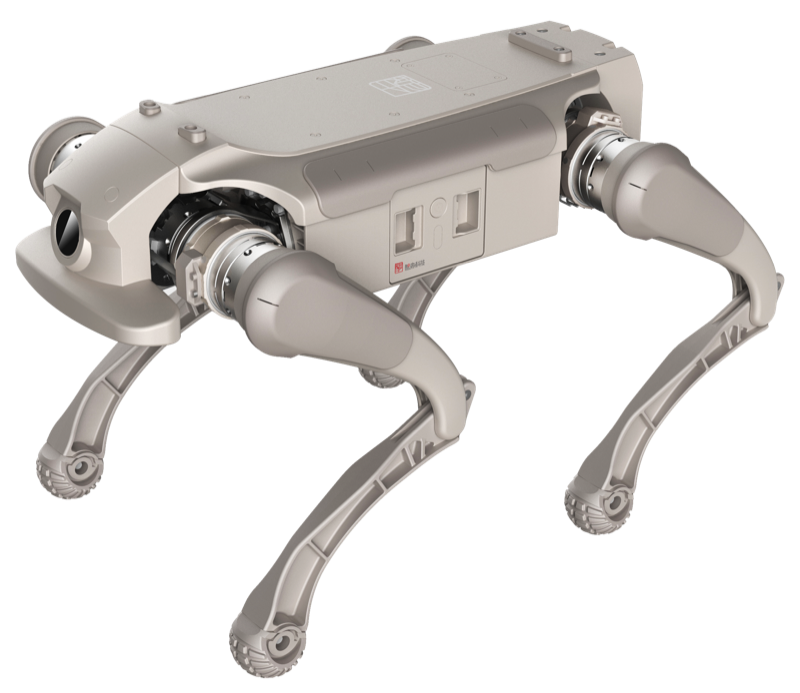
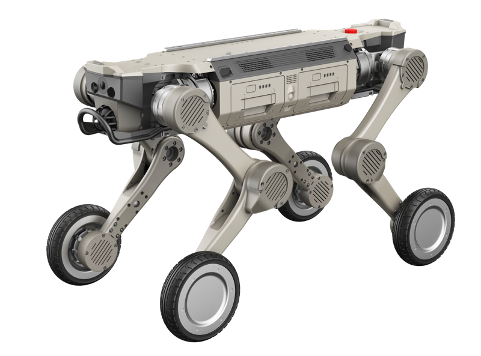
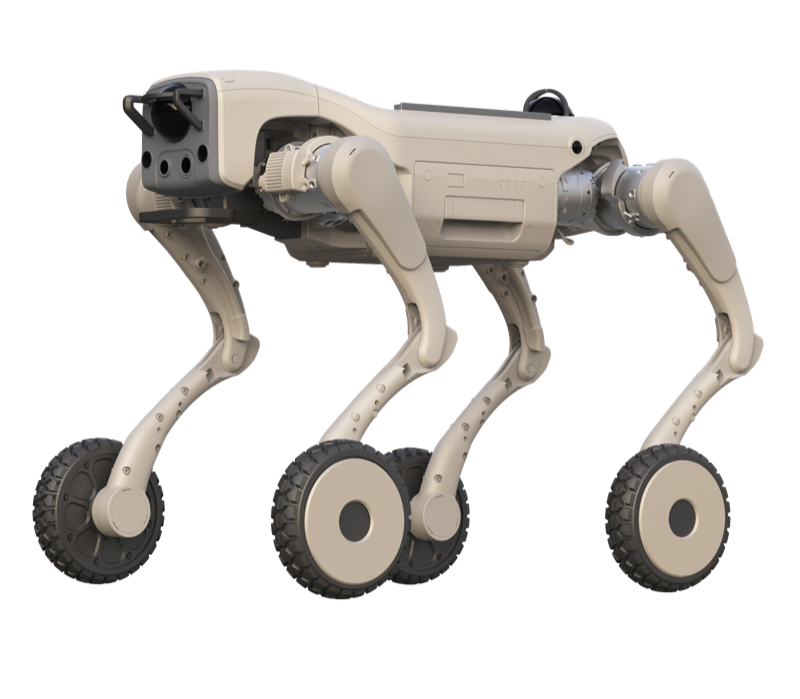

**开发者文档**

[智身钢镚L1文档](https://zhuanshunjishi.github.io/note-test/l1/) · [智身铜锤M1文档](https://zhuanshunjishi.github.io/note-test/m1/)

# 产品开发文档

查看智身钢镚L1 和智身钢镚M1 的设备使用指南、SDK 开发流程与接口参考。

## 选择产品

### 智身钢镚L1

四足机器人系列

[查看文档 →](https://zhuanshunjishi.github.io/note-test/l1/)

### 智身钢镚M1

轮足机器人系列

[查看文档 →](https://zhuanshunjishi.github.io/note-test/m1/)

### 智身钢镚L2

Coming soon 即将推出
