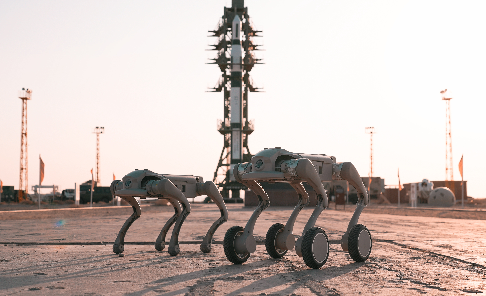

# 智身钢镚L1 SDK 开发文档

## 关于本指南

本指南适用于钢镚L1、L1-W、L1 EDU、L1-W EDU 系列产品，内容涵盖产品规格、配件配置、设备操作、网络连接、系统架构、SDK 通信、硬件接口、SDK 构建、示例调试和本体相机视频流。

第一次使用机器人时，建议先了解产品型号和安全要求，再完成开关机、遥控器、网络和 SSH 连接。进行 SDK 开发前，应确认机器人型号、固件版本、控制模式和现场安全条件。

## 从这里开始

- 首次使用：先看[产品规格对比](./md/01-product-specifications.md)和[设备操作、遥控器与 App 使用说明](./md/05-device-controller-and-app-guide.md)。
- HighLevel 开发：先看[硬件、软件与结构架构](./md/03-system-architecture.md)，再阅读[SDK 软件服务接口](./md/06-sdk-service-interfaces.md)及其五个接口文档，最后按[SDK 开发与运行指南](./md/08-sdk-development-guide.md)完成构建，并按[官方示例使用说明](./md/09-official-examples.md)进行联调。
- 硬件接口开发：先阅读[二次开发硬件接口说明](./md/04-hardware-interfaces.md)，确认供电和通信条件。安装尺寸见[钢镚L1 尺寸与安装参考](./md/03-system-architecture.md#dimensions)。
- 视频开发：先完成机器人网络连接，再阅读[本体相机视频流](./md/07-onboard-camera-stream.md)并选择对应的播放或取帧方式。

## 文档目录

1. [产品规格对比](./md/01-product-specifications.md)
   对比各型号的产品图片、机械结构、运动能力、电池续航、算力、传感器、SDK 和导航能力，适合产品选型和版本差异确认。
2. [配件列表](./md/02-accessories.md)
   介绍图传套装、充电桩、电极片、航空箱、电池、遥控器和智航 Pro，包含图片、规格、适配机型及注意事项。
3. [硬件、软件与结构架构](./md/03-system-architecture.md)
   说明机器人本体、Remote、SDK 和上位机之间的关系，以及 UDP 通信、心跳连接、工程目录和静态库。提供钢镚L1 尺寸图和负载设计参考，并按 L1、L1-W 和 L1 EDU 提供模型下载。
4. [二次开发硬件接口说明](./md/04-hardware-interfaces.md)
   说明机身拓展接口、供电、网络、USB 和串行通信。
5. [设备操作、遥控器与 App 使用说明](./md/05-device-controller-and-app-guide.md)
   介绍安全检查、开关机、充电、尾灯状态、遥控器、App、机器人 Wi-Fi 和 SSH 登录。
6. [SDK 软件服务接口](./md/06-sdk-service-interfaces.md)
   软件服务接口总入口，说明五类服务的关系、默认 UDP 通道和调用顺序。具体接口分别查看：[控制指令](./md/06-01-control-commands.md)、[传感器实时上报](./md/06-02-real-time-sensor-data.md)、[心跳检测](./md/06-03-heartbeat.md)、[WiFi 热点配置](./md/06-04-wifi-hotspot-configuration.md)、[故障信息查询](./md/06-05-fault-information.md)。
7. [本体相机视频流](./md/07-onboard-camera-stream.md)
   介绍 RTSP 视频流地址，以及使用 FFplay、GStreamer、VLC 和 OpenCV 获取本体相机画面的方法。
8. [SDK 开发与运行指南](./md/08-sdk-development-guide.md)
   介绍 Linux 环境准备、SDK 编译、Demo 运行、自定义工程和调试排查。
9. [官方示例使用说明](./md/09-official-examples.md)
   介绍 Remote 与 SDK 两个官方示例的下载编译、键盘操作、控制权切换、状态检查和常见问题。

> 任何会影响机器人运动的程序连接实体设备前，都应清理周围人员和障碍物，并准备可靠的急停或阻尼切换方式。
