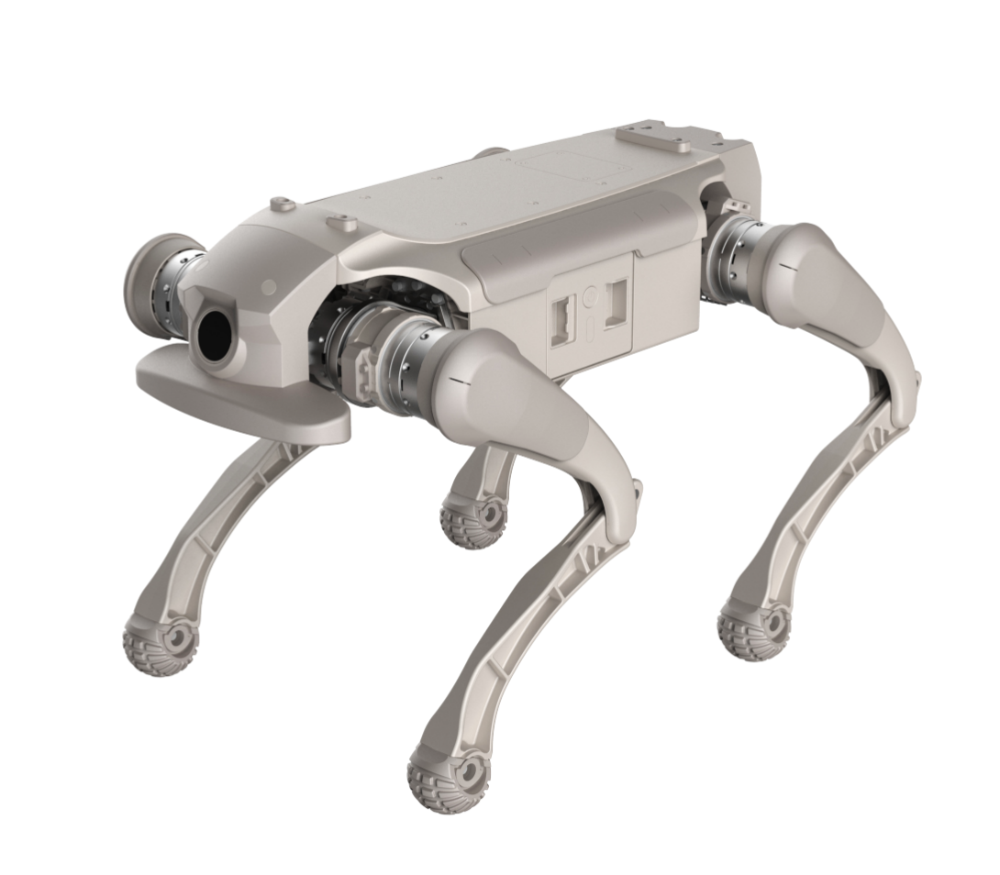
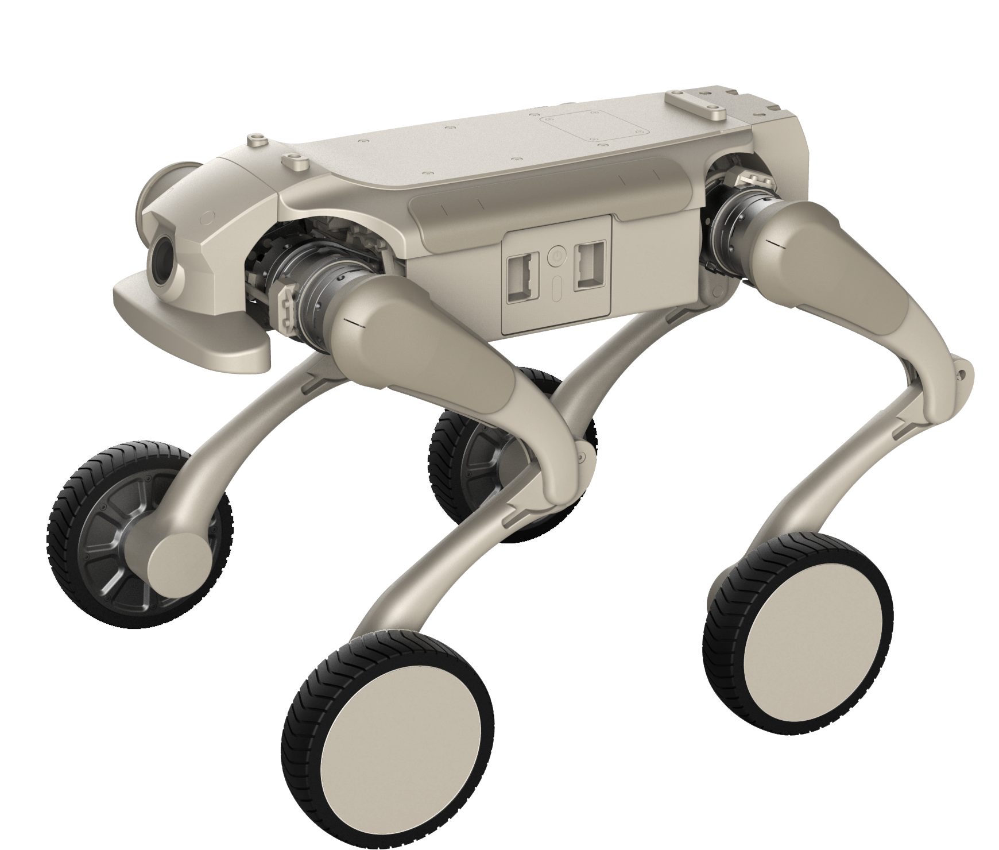
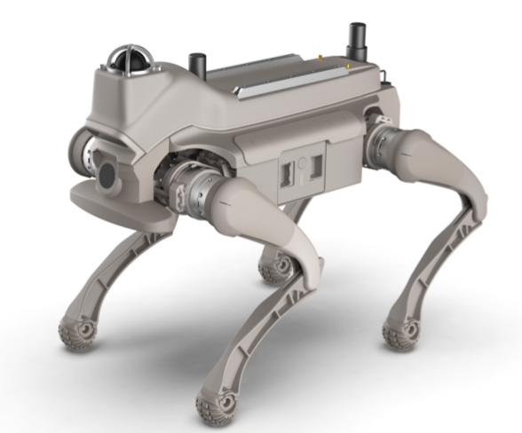
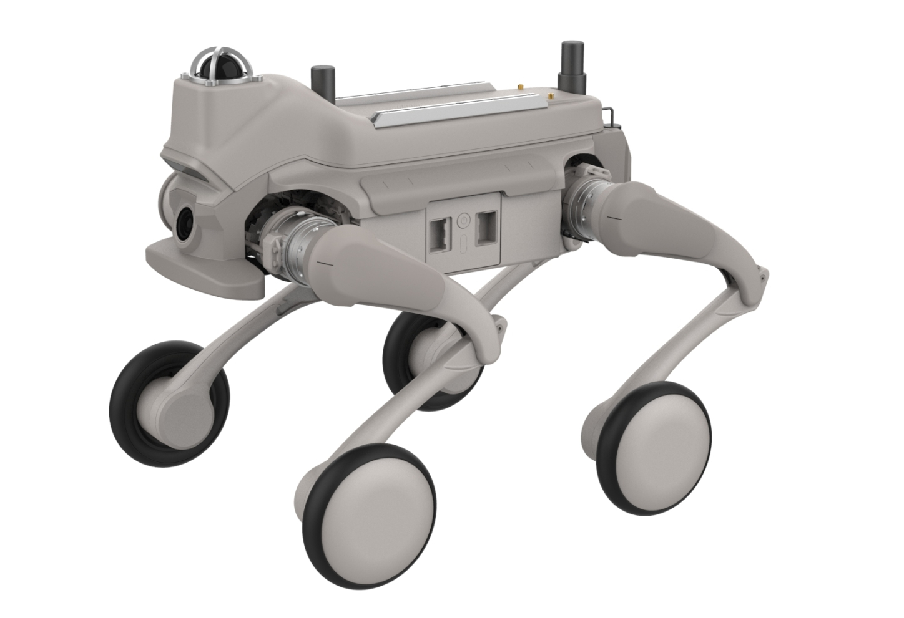
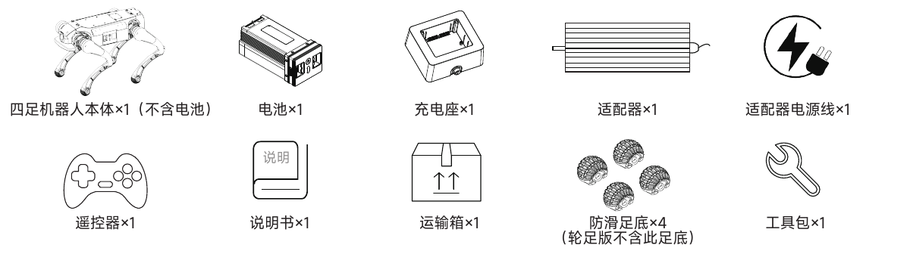

# 产品规格对比

[返回首页](../index.md) | [配件列表](./02-accessories.md) | [硬件、软件与结构架构](./03-system-architecture.md)


## L1 系列纵向规格对比


<div class="specification-table" role="region" aria-label="L1 系列规格对比表" tabindex="0">
<table>
  <colgroup>
    <col style="width:16%;">
    <col style="width:14%;">
    <col style="width:14%;">
    <col style="width:14%;">
    <col style="width:14%;">
    <col style="width:14%;">
    <col style="width:14%;">
  </colgroup>
  <thead>
    <tr>
      <th style="text-align:left;vertical-align:bottom;">对比项目</th>
      <th style="text-align:center;vertical-align:bottom;">
        <a href="../assets/images/products/l1.jpeg"></a>
        <br><strong>L1</strong>
      </th>
      <th style="text-align:center;vertical-align:bottom;">
        <a href="../assets/images/products/l1-w.jpeg"></a>
        <br><strong>L1-W</strong>
      </th>
      <th style="text-align:center;vertical-align:bottom;">
        <a href="../assets/images/products/l1-edu.jpeg"></a>
        <br><strong>L1 EDU</strong>
      </th>
      <th style="text-align:center;vertical-align:bottom;">
        <a href="../assets/images/products/l1-w-edu.jpeg"></a>
        <br><strong>L1-W EDU</strong>
      </th>
      <th style="text-align:center;vertical-align:bottom;">
        <a href="../assets/images/products/l1-edu.jpeg"></a>
        <br><strong>L1 EDU<br>智航 Pro 版</strong>
      </th>
      <th style="text-align:center;vertical-align:bottom;">
        <a href="../assets/images/products/l1-w-edu.jpeg"></a>
        <br><strong>L1-W EDU<br>智航 Pro 版</strong>
      </th>
    </tr>
  </thead>
  <tbody>
    <tr>
      <th class="specification-label">产品定位</th>
      <td>通用型智能仿生四足机器人</td>
      <td>小型轮足仿生四足机器人</td>
      <td>点足教育、科研开发版</td>
      <td>轮足教育、科研开发版</td>
      <td>点足自主导航开发版</td>
      <td>轮足自主导航开发版</td>
    </tr>
    <tr>
      <th class="specification-label">适合场景</th>
      <td>步态、平衡、关节控制、通用四足应用</td>
      <td>安防、巡检、平整路面移动、轮足算法</td>
      <td>教学、科研、感知、ROS、导航二次开发</td>
      <td>教学、科研、轮足感知与导航二次开发</td>
      <td>建图、定位、导航、规划、避障应用</td>
      <td>轮足建图、定位、导航、规划、避障应用</td>
    </tr>
    <tr>
      <th colspan="7" class="specification-section">本体与机械结构</th>
    </tr>
    <tr>
      <th class="specification-label">本体形态</th>
      <td>点足四足</td>
      <td>轮足四足</td>
      <td>点足四足 + EDU 上装</td>
      <td>轮足四足 + EDU 上装</td>
      <td>点足四足 + EDU 上装 + 智航PRO</td>
      <td>轮足四足 + EDU 上装 + 智航PRO</td>
    </tr>
    <tr>
      <th class="specification-label">全身自由度</th>
      <td>12 dof</td>
      <td>16 dof</td>
      <td>12 dof</td>
      <td>16 dof</td>
      <td>12 dof</td>
      <td>16 dof</td>
    </tr>
    <tr>
      <th class="specification-label">站立尺寸<br>长 × 宽 × 高</th>
      <td>约 630 × 360 × 415 mm</td>
      <td>约 630 × 430 × 485 mm</td>
      <td>约 630 × 360 × 525 mm</td>
      <td>约 630 × 430 × 585 mm</td>
      <td>约 630 × 360 × 525 mm</td>
      <td>约 630 × 430 × 585 mm</td>
    </tr>
    <tr>
      <th class="specification-label">趴地尺寸<br>长 × 宽 × 高</th>
      <td>约 670 × 425 × 145 mm</td>
      <td>约 690 × 540 × 165 mm</td>
      <td>约 670 × 425 × 255 mm</td>
      <td>约 690 × 540 × 275 mm</td>
      <td>约 670 × 425 × 255 mm</td>
      <td>约 690 × 540 × 275 mm</td>
    </tr>
    <tr>
      <th class="specification-label">整机重量</th>
      <td>15 kg</td>
      <td>22 kg</td>
      <td>17 KG</td>
      <td>24 KG</td>
      <td>17 KG</td>
      <td>24 KG</td>
    </tr>
    <tr>
      <th class="specification-label">关节电机</th>
      <td>12 个一体化关节模组</td>
      <td>12 个一体化关节模组</td>
      <td>12 个一体化关节模组</td>
      <td>12 个一体化关节模组</td>
      <td>12 个一体化关节模组</td>
      <td>12 个一体化关节模组</td>
    </tr>
    <tr>
      <th class="specification-label">轮毂电机</th>
      <td>无</td>
      <td>4 个一体化轮毂电机</td>
      <td>无</td>
      <td>4 个一体化轮毂电机</td>
      <td>无</td>
      <td>4 个一体化轮毂电机</td>
    </tr>
    <tr>
      <th class="specification-label">足端 / 轮胎</th>
      <td>防滑足端</td>
      <td>6 英寸实心胎</td>
      <td>防滑足端</td>
      <td>6 英寸实心胎</td>
      <td>防滑足端</td>
      <td>6 英寸实心胎</td>
    </tr>
    <tr>
      <th class="specification-label">最大关节扭矩</th>
      <td>48 N·m</td>
      <td>48 N·m</td>
      <td>48 N·m</td>
      <td>48 N·m</td>
      <td>48 N·m</td>
      <td>48 N·m</td>
    </tr>
    <tr>
      <th colspan="7" class="specification-section">运动与通过能力</th>
    </tr>
    <tr>
      <th class="specification-label">最大速度</th>
      <td>3.7 m/s</td>
      <td>3.7 m/s</td>
      <td>3.7 m/s</td>
      <td>3.7 m/s</td>
      <td>3.7 m/s</td>
      <td>3.7 m/s</td>
    </tr>
    <tr>
      <th class="specification-label">最大载荷</th>
      <td>约 8 kg<br>极限约 10 kg</td>
      <td>约 10 kg<br>极限约 12 kg</td>
      <td>约 5 kg</td>
      <td>约 5 kg</td>
      <td>约 5 kg</td>
      <td>约 5 kg</td>
    </tr>
    <tr>
      <th class="specification-label">最大攀爬角度</th>
      <td>标准环境 30°<br>极限可达 40°</td>
      <td>标准环境 30°<br>极限可达 40°</td>
      <td>标准环境 30°<br>极限可达 40°</td>
      <td>标准环境 30°<br>极限可达 40°</td>
      <td>标准环境 30°<br>极限可达 40°</td>
      <td>标准环境 30°<br>极限可达 40°</td>
    </tr>
    <tr>
      <th class="specification-label">基础动作</th>
      <td>站立、卧倒、阻尼、俯仰身形、高低身形、水平转身</td>
      <td>站立、卧倒、阻尼、俯仰身形、高低身形、水平转身</td>
      <td>站立、卧倒、阻尼、俯仰身形、高低身形、水平转身</td>
      <td>站立、卧倒、阻尼、俯仰身形、高低身形、水平转身</td>
      <td>站立、卧倒、阻尼、俯仰身形、高低身形、水平转身</td>
      <td>站立、卧倒、阻尼、俯仰身形、高低身形、水平转身</td>
    </tr>
    <tr>
      <th class="specification-label">特技动作</th>
      <td>向前跳、向上跳、双腿站立、后空翻、打招呼等</td>
      <td>/</td>
      <td>/</td>
      <td>/</td>
      <td>/</td>
      <td>/</td>
    </tr>
    <tr>
      <th colspan="7" class="specification-section">电池、续航与环境</th>
    </tr>
    <tr>
      <th class="specification-label">续航时间</th>
      <td>1-2 h</td>
      <td>1-2 h</td>
      <td>0.5-1.5 h</td>
      <td>0.5-1.5 h</td>
      <td>0.5-1.5 h</td>
      <td>0.5-1.5 h</td>
    </tr>
    <tr>
      <th class="specification-label">最长续航里程</th>
      <td>6 km</td>
      <td>9 km</td>
      <td>/</td>
      <td>/</td>
      <td>/</td>
      <td>/</td>
    </tr>
    <tr>
      <th class="specification-label">电池参数</th>
      <td>标称 5 Ah<br>额定 4.6 Ah<br>43.2 V</td>
      <td>标称 5 Ah<br>额定 4.6 Ah<br>43.2 V</td>
      <td>标称 5 Ah<br>额定 4.6 Ah<br>43.2 V</td>
      <td>标称 5 Ah<br>额定 4.6 Ah<br>43.2 V</td>
      <td>标称 5 Ah<br>额定 4.6 Ah<br>43.2 V</td>
      <td>标称 5 Ah<br>额定 4.6 Ah<br>43.2 V</td>
    </tr>
    <tr>
      <th class="specification-label">充电时长</th>
      <td>约 1 h</td>
      <td>约 1 h</td>
      <td>约 1 h</td>
      <td>约 1 h</td>
      <td>约 1 h</td>
      <td>约 1 h</td>
    </tr>
    <tr>
      <th class="specification-label">工作温度</th>
      <td>0℃-40℃</td>
      <td>0℃-40℃</td>
      <td>0℃-40℃</td>
      <td>0℃-40℃</td>
      <td>0℃-40℃</td>
      <td>0℃-40℃</td>
    </tr>
    <tr>
      <th class="specification-label">本体防护等级</th>
      <td>IP54</td>
      <td>IP54</td>
      <td>IP54</td>
      <td>IP54</td>
      <td>IP54</td>
      <td>IP54</td>
    </tr>
    <tr>
      <th colspan="7" class="specification-section">计算与感知</th>
    </tr>
    <tr>
      <th class="specification-label">本体基础算力</th>
      <td>八核高性能 CPU</td>
      <td>八核高性能 CPU</td>
      <td>八核高性能 CPU</td>
      <td>八核高性能 CPU</td>
      <td>八核高性能 CPU</td>
      <td>八核高性能 CPU</td>
    </tr>
    <tr>
      <th class="specification-label">拓展算力</th>
      <td>未配置</td>
      <td>未配置</td>
      <td>Jetson Orin NX 16 GB<br>约 100 TOPS</td>
      <td>Jetson Orin NX 16 GB<br>约 100 TOPS</td>
      <td>Jetson Orin NX 16 GB<br>约 100 TOPS</td>
      <td>Jetson Orin NX 16 GB<br>约 100 TOPS</td>
    </tr>
    <tr>
      <th class="specification-label">激光雷达</th>
      <td>未配置</td>
      <td>未配置</td>
      <td>Mid-360</td>
      <td>Mid-360</td>
      <td>Mid-360</td>
      <td>Mid-360</td>
    </tr>
    <tr>
      <th class="specification-label">深度相机</th>
      <td>未配置</td>
      <td>未配置</td>
      <td>RealSense 深度相机</td>
      <td>RealSense 深度相机</td>
      <td>RealSense 深度相机</td>
      <td>RealSense 深度相机</td>
    </tr>
    <tr>
      <th class="specification-label">GNSS 定位模块</th>
      <td>未配置</td>
      <td>未配置</td>
      <td>标配</td>
      <td>标配</td>
      <td>标配</td>
      <td>标配</td>
    </tr>
    <tr>
      <th class="specification-label">RTK 天线</th>
      <td>未配置</td>
      <td>未配置</td>
      <td>标配</td>
      <td>标配</td>
      <td>标配</td>
      <td>标配</td>
    </tr>
    <tr>
      <th class="specification-label">5G 通信模块</th>
      <td>未配置</td>
      <td>未配置</td>
      <td>标配</td>
      <td>标配</td>
      <td>标配</td>
      <td>标配</td>
    </tr>
    <tr>
      <th colspan="7" class="specification-section">SDK 与软件能力</th>
    </tr>
    <tr>
      <th class="specification-label">二次开发</th>
      <td>支持</td>
      <td>支持</td>
      <td>支持</td>
      <td>支持</td>
      <td>支持</td>
      <td>支持</td>
    </tr>
    <tr>
      <th class="specification-label">SDK 机型枚举</th>
      <td><code>MODEL_XG</code></td>
      <td><code>MODEL_XGW</code></td>
      <td><code>MODEL_XG</code></td>
      <td><code>MODEL_XGW</code></td>
      <td><code>MODEL_XG</code></td>
      <td><code>MODEL_XGW</code></td>
    </tr>
    <tr>
      <th class="specification-label">导航软件包</th>
      <td>未包含</td>
      <td>未包含</td>
      <td>赠送 <a href="https://github.com/zsibot/genisom_roamerx_open">智航 Open</a><br>GitHub 下载</td>
      <td>赠送 <a href="https://github.com/zsibot/genisom_roamerx_open">智航 Open</a><br>GitHub 下载</td>
      <td>标配智航 Pro</td>
      <td>标配智航 Pro</td>
    </tr>
    <tr>
      <th class="specification-label">建图、定位、导航</th>
      <td>需自行开发</td>
      <td>需自行开发</td>
      <td>智航 Open 提供</td>
      <td>智航 Open 提供</td>
      <td>支持</td>
      <td>支持</td>
    </tr>
    <tr>
      <th class="specification-label">规划与避障</th>
      <td>需自行开发</td>
      <td>需自行开发</td>
      <td>在智航 Open 基础上需自行开发</td>
      <td>在智航 Open 基础上需自行开发</td>
      <td>支持</td>
      <td>支持</td>
    </tr>
  </tbody>
</table>
</div>

## 尺寸、负载与模型资料

进行上装或结构设计时，请查看[钢镚L1 尺寸与安装参考](./03-system-architecture.md#dimensions)，以及[负载设计参考 PDF 和外观 STP 模型下载](./03-system-architecture.md#payload-model-downloads)。

## 快速选型结论

- 重点是步态、平衡、关节控制或通用四足开发时，优先选择 L1。
- 重点是轮式移动、低噪音、较长续航里程和轮足控制时，选择 L1-W。
- 需要激光雷达、深度相机、Orin NX、GNSS/RTK、5G 或 ROS 导航开发环境时，选择 EDU。
- 希望直接获得建图、定位、导航、规划、避障和回充软件能力时，选择智航 Pro 版。
- EDU 上装会占用本体载荷并增加功耗。计算可用载荷和续航时，不能直接照搬裸机参数。
- 智航 Pro包含的“回充”是软件能力，实际自动回充还需要充电桩、机身电极片和正确配置的地图定位环境，详见[配件列表](./02-accessories.md#charging-dock)。

<a id="developer-differences"></a>

## 开发者需要关注的机型差异

### SDK 机型识别

钢镚L1 SDK 的 <code>Model</code> 枚举可区分点足和轮足机型：

<div class="specification-table model-table" role="region" aria-label="SDK 机型枚举表" tabindex="0">
<table>
  <thead>
    <tr>
      <th class="specification-label">枚举值</th>
      <th class="specification-label">对应设备</th>
      <th class="specification-label">对应机型</th>
    </tr>
  </thead>
  <tbody>
    <tr>
      <td><code>MODEL_XG</code></td>
      <td>L1</td>
      <td>点足四足机器人</td>
    </tr>
    <tr>
      <td><code>MODEL_XGW</code></td>
      <td>L1-W</td>
      <td>轮足四足机器人</td>
    </tr>
  </tbody>
</table>
</div>

程序启动后应先调用 <code>GetModel()</code>，再按返回机型启用对应功能：

```cpp
const auto model = robot.GetModel();

if (model == zsibot::Model::MODEL_XG) {
    // L1 点足逻辑
} else if (model == zsibot::Model::MODEL_XGW) {
    // L1-W 轮足逻辑
}
```

自动识别只告诉程序当前机型，不代表所有动作都可以直接执行。应用程序还需要结合固件版本、当前运动模式、现场空间和安全状态禁用不适用动作。

### 功能与安全边界

L1 与 L1-W 都支持站立、卧倒、阻尼、俯仰身形、高低身形和水平转身等基础动作。L1 支持向前跳、向上跳、双腿站立、后空翻和打招呼等特技动作；L1-W 为轮足结构，不列入上述点足特技。

特技动作会显著增加关节负载。开发和演示时应在空旷、防滑、无人员靠近的区域进行，并提前准备急停或切换阻尼模式的手段。安装 EDU 上装后，重心、载荷和惯量发生变化，必须重新验证动作安全性。

## 标准包装与选配

标准包装包括机器人本体、电池、充电座、电源适配器及电源线、遥控器、说明书、运输箱和工具包。点足版另带 4 个防滑足底；轮足版不包含点足足底。实际装箱内容会因配置和合同不同而变化，开箱后应按装箱单核对。

充电桩、远距图传、额外电池、航空箱、不同遥控器和智航 Pro 软件的详细说明，请查看[配件列表](./02-accessories.md)。

## 参数说明

- “极限”速度、载荷、坡度不应作为日常连续运行工况。
- 续航会受到载荷、速度、路面、坡度、温度、电池状态、上装功耗和控制方式影响。
- IP54 不等于防水。不要在暴雨、积水、浸水、腐蚀性环境或 0℃-40℃ 之外使用。
