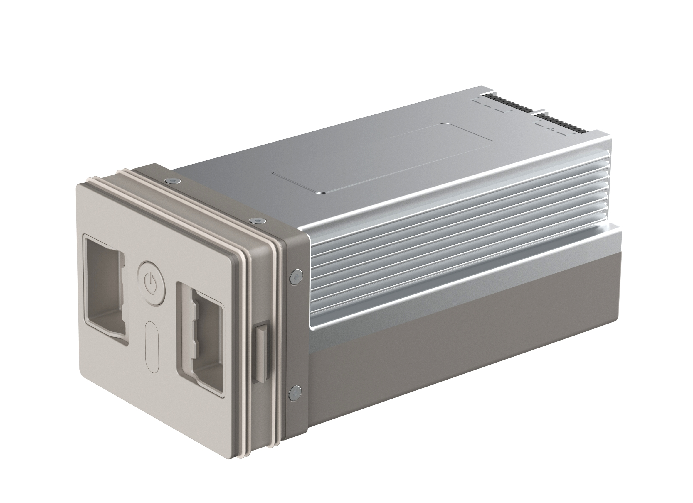
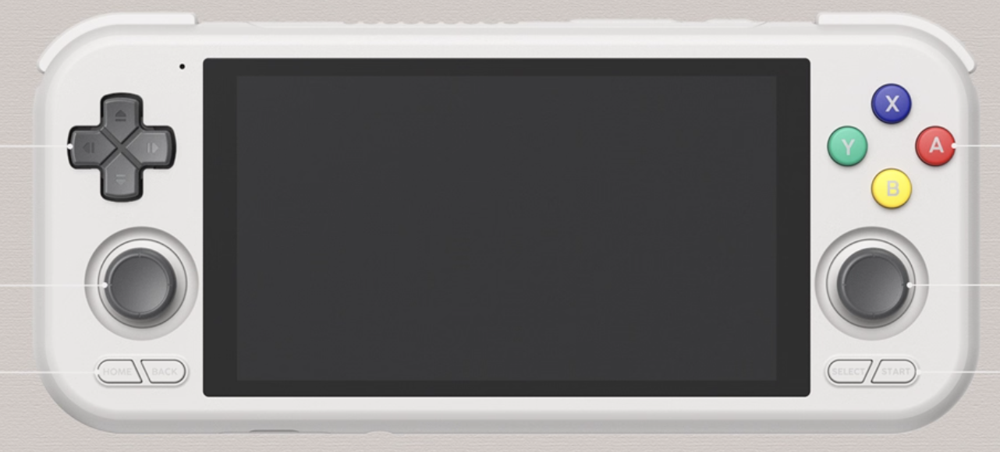
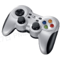
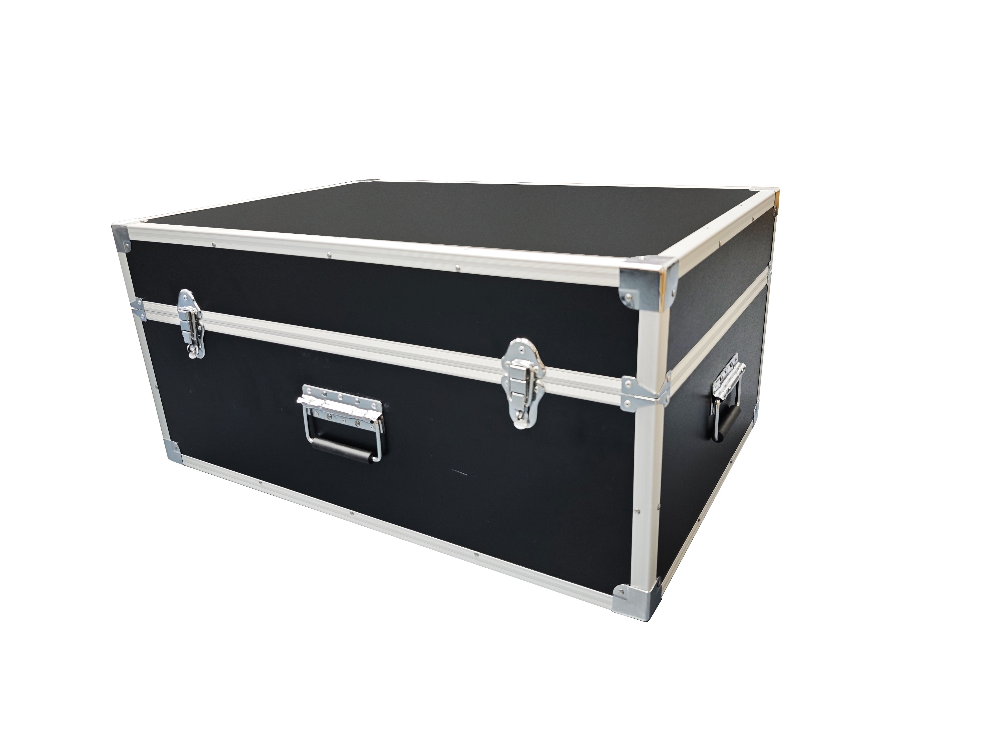
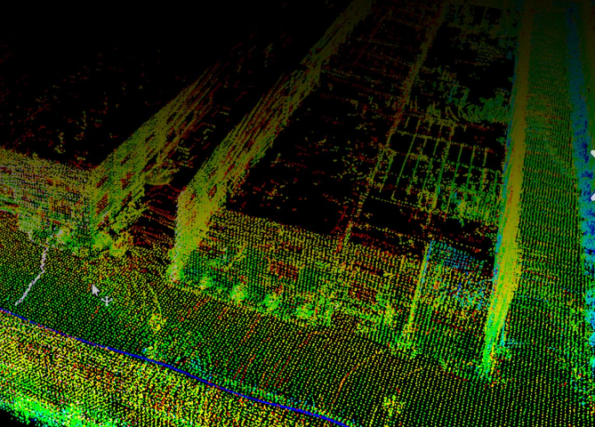
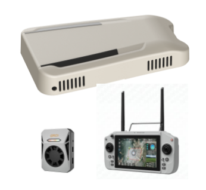
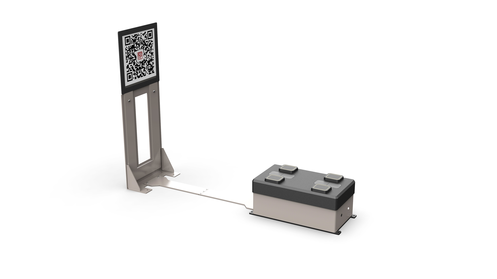

# 配件列表

[返回首页](../index.md) | [产品规格对比](./01-product-specifications.md) | [设备操作、遥控器与 App 使用说明](./05-device-controller-and-app-guide.md)

## 快速目录

| 图片 | 配件 | 主要用途 | 适配范围 |
| --- | --- | --- | --- |
|  | [电池 L1 系列](#battery) | 机器人供电或备用电池 | L1 系列 |
|  | [带屏遥控器 L1 系列](#screen-controller) | 运动控制、图像显示和目标选择 | L1 系列 |
|  | [手持遥控器 L1 系列](#handheld-controller) | 基本运动控制 | L1 系列 |
|  | [航空箱 L1 / L1-W](#flight-case) | 运输、搬运和机身防护 | L1 系列 |
|  | [智航 Pro](#navigation-pro) | 建图、定位、导航、规划、避障和回充 | L1 EDU、L1-W EDU |
|  | [远距图传套装 L1 系列](#video-kit) | 远距离高清图像传输和带屏遥控 | L1、L1-W |
|  | [充电桩 L1 系列](#charging-dock) | 配合导航软件实现机器人自主回充 | L1、L1-W、L1 EDU、L1-W EDU |
|  | [充电电极片](#electrode) | 机身与充电桩之间的充电接触组件 | L1、L1-W、L1 EDU、L1-W EDU |

## 电池 L1 系列

  

### 基本信息

| 参数 | 数值 |
| --- | --- |
| 用途 | 为 L1 系列仿生四足机器人供电或作为备用电池 |
| 尺寸 | 约 20 × 12 × 10 cm |
| 重量 | 约 1.7 kg |
| 电芯材料 | 三元锂 |
| 标称容量 | 5 Ah |
| 额定容量 | 4.6 Ah |
| 电压 | 43.2 V |
| 循环寿命 | 500 次循环后容量约 60%，具体以实际电池规格为准 |

### 使用建议

只使用厂家指定的充电设备。电池出现鼓包、漏液、破损或异常发热时，应立即停止使用。

## 带屏遥控器 L1 系列

  

### 基本信息

| 参数 | 说明 |
| --- | --- |
| 主要作用 | 控制机器狗、显示图像、选择追踪目标 |
| 尺寸 | 185 × 83 × 16 mm |
| 重量 | 261 g |
| 电池 | 5000 mAh |
| 充电 | 支持 18 W 快充 |
| 屏幕 | 4.7 英寸，750 × 1334 触摸屏 |
| 存储 | 128 GB UFS 3.1 + TF 卡槽 |

### 使用建议

连接、控制和 App 操作流程请查看[设备操作、遥控器与 App 使用说明](./05-device-controller-and-app-guide.md)。

## 手持遥控器 L1 系列

  

### 基本信息

| 参数 | 说明 |
| --- | --- |
| 主要作用 | 控制机器狗的基本运动 |
| 尺寸 | 160 × 100 × 70 mm |
| 重量 | 280 g |
| 无线连接 | 2.4 GHz |
| 反馈 | 双振动 |

### 使用建议

手持遥控器适合基础动作和现场调试，不包含带屏遥控器的图像显示、触摸操作和目标选择能力。

## 航空箱

  

### 基本信息

航空箱采用铝材结构，配有万向轮和顶部 / 侧面双提手，用于机器人跨场地搬运和运输防护。L1 与 L1-W 外形尺寸不同，必须按机型选择。

| 型号 | 适配机型 | 外部尺寸 | 重量 |
| --- | --- | --- | --- |
| 航空箱 L1 | L1 点足系列 | 46 × 34 × 85 cm | 10.3 kg |
| 航空箱 L1-W | L1-W 轮足系列 | 53 × 37 × 85 cm | 11.9 kg |

### 运输建议

运输前应关闭机器人电源，并固定机器人本体和电池。

## 智航 Pro

  

### 基本信息

上图是智航 Pro 配置的点云建图效果图，不是独立硬件照片。

| 字段 | 说明 |
| --- | --- |
| 适配机型 | L1 EDU、L1-W EDU |
| 功能 | 建图、定位、导航、规划、避障、回充 |
| 交付内容 | 智航 Pro 软件包、SDK 接口、标准版导航 App |
| 二次开发 | 支持 |

## 远距图传套装 L1 系列

  

### 基本信息

| 字段 | 说明 |
| --- | --- |
| 主要作用 | 在空旷环境中进行高清图像实时传输，支持最远约 1 km 图传 |
| 套装组成 | G20 遥控器、GR01 接收机、远距离外置天线 |
| 软件适配 | 适配 钢镚L1 专用 App |
| 适配机型 | L1、L1-W |

### 使用建议

标称 1 km 图传距离适用于无遮挡的空旷环境，遮挡和同频干扰会影响有效距离。IP54 不代表可浸水使用。

## 充电桩 L1 系列

  

### 基本信息

| 字段 | 说明 |
| --- | --- |
| 主要作用 | 配合导航软件实现机器人自主回充 |
| 适配机型 | L1、L1-W、L1 EDU、L1-W EDU |
| 主要组成 | 高亮定位二维码、折叠式固定支架、充电底座、充电状态指示 |
| 包装箱尺寸 | 580 × 262 × 371 mm |
| 产品毛重 | 约 12 kg，含包装箱 |

## 充电电极片

充电电极片安装在机器人机身上，与充电桩触点配合完成充电。

L1 EDU 和 L1-W EDU 标配电极片。L1 和 L1-W 使用充电桩回充前，请确认机身已安装电极片。
