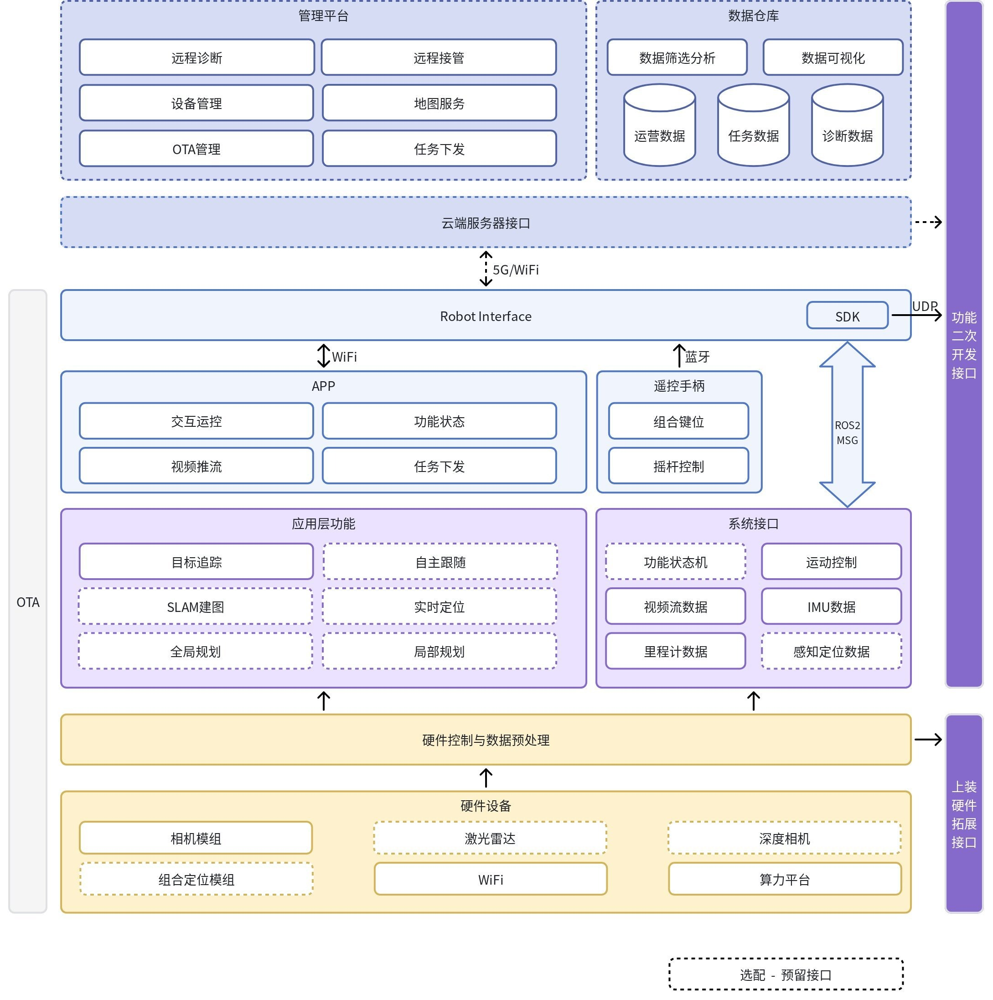
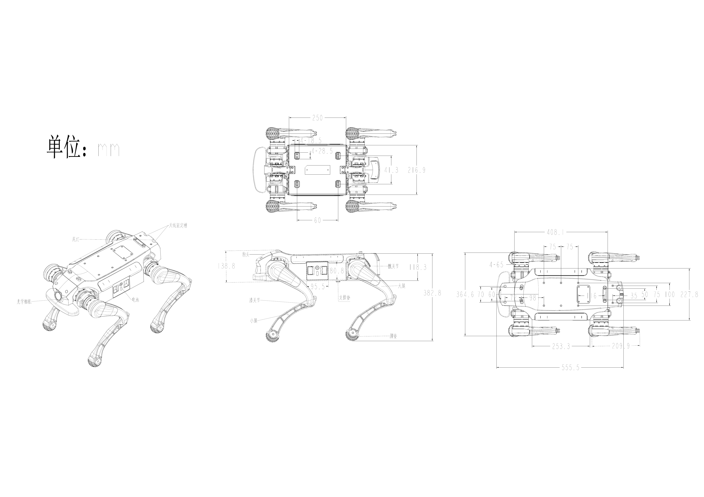
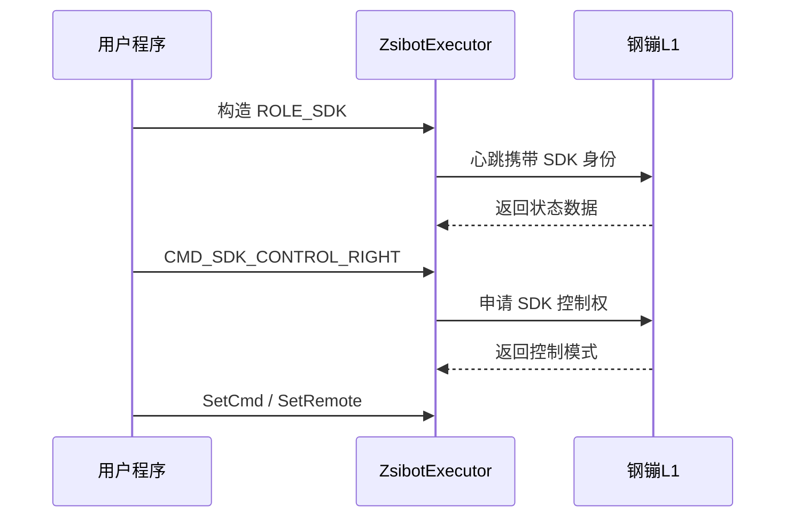
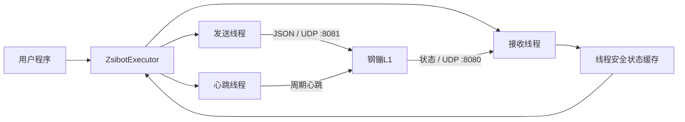
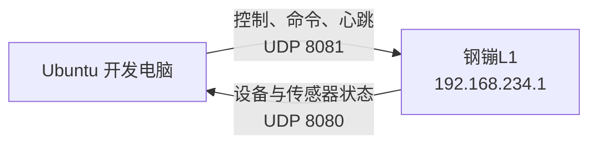

# 硬件、软件与结构架构

[返回首页](../index.md) | [硬件接口](./04-hardware-interfaces.md) | [SDK 软件服务接口](./06-sdk-service-interfaces.md) | [SDK 开发与运行指南](./08-sdk-development-guide.md) | [本体相机视频流](./07-onboard-camera-stream.md)

## 系统架构

钢镚L1 整机由硬件设备、硬件控制与数据预处理、应用与系统接口、Robot Interface 和云端管理等部分组成。



该图展示整机功能分层，不代表 SDK 已开放的接口清单。虚线框为选配或预留接口，实际支持范围由机型、固件和交付配置决定。

## 结构与安装

<a id="dimensions"></a>

### 钢镚L1 尺寸与安装参考



<a id="payload-model-downloads"></a>

### 负载设计参考与模型下载

#### 钢镚L1

| 资料 | 用途 | 下载 |
| --- | --- | --- |
| 钢镚L1 负载能力设计参考 | 查看不同负载质心位置对应的负载参考值、坐标定义和实验条件 | [下载 PDF](../assets/downloads/zsl-1-payload-design-reference.pdf) |
| 钢镚L1 外观模型 | 用于外观尺寸查看、上装布局和空间配合参考 | <a href="../assets/downloads/zsl-1-exterior-model.stp" download>下载 STP 模型</a> |
| 钢镚L1 URDF 模型 | 用于查看机器人连杆、关节及碰撞几何 | <a href="../assets/downloads/zsl-1-urdf.rar" download>下载 URDF</a> |

#### L1-W

| 资料 | 用途 | 下载 |
| --- | --- | --- |
| L1-W 外观模型 | 用于查看外观尺寸和规划上装布局，解压 ZIP 后获得 STP 文件 | <a href="../assets/downloads/l1-w-exterior-model.zip" download>下载 STP 模型</a> |
| L1-W URDF 模型 | 用于查看连杆、关节和网格，主模型为 `xg_wheel_su/urdf/xg_wheel_su.urdf` | <a href="../assets/downloads/l1-w-urdf.rar" download>下载 URDF</a> |

#### L1 EDU

| 资料 | 用途 | 下载 |
| --- | --- | --- |
| L1 EDU 外观模型 | 用于查看外观尺寸和规划上装布局 | <a href="../assets/downloads/l1-edu-exterior-model.step" download>下载 STEP 模型</a> |

## SDK 与控制权

### SDK 能力

新版钢镚L1 SDK 通过 `zsibot::ZsibotExecutor` 提供统一的 HighLevel C++ 接口。

主要能力包括：

- 发送离散命令和连续遥控量
- 申请不同类型的控制权
- 读取电池、设备、模式、IMU、里程计、关节和故障状态
- 通过 JSON over UDP 与机器狗进行 HighLevel 通信
- 通过独立线程处理发送、接收和心跳
- 支持 `x86_64` 和 `aarch64` Linux 平台

### 控制权类型

| 控制权 | 含义 | 适用场景 |
| --- | --- | --- |
| Remote | 遥控器控制权 | 遥控操作 |
| SDK | 二次开发导航控制权 | 响应较小的速度指令（如 0.05 m/s）、回充等场景 |
| General SDK | 通用二次开发导航控制权 | 响应较大的速度指令（如 3 m/s）、爬楼梯等场景 |

`Role` 表示程序连接 SDK 时使用的通信身份，控制权表示机器人当前接受哪一类控制源，两者不是同一个概念。构造 `ROLE_SDK` 不等于已经获得 SDK 控制权；程序仍需发送相应的控制权命令，并根据 `GetFunctionMode()` 的反馈确认切换结果。



## 通信与连接

### HighLevel 通信结构



构造 `ZsibotExecutor` 时启动通信线程，公开的 getter 从内部状态缓存读取最近一次状态。析构对象时停止通信并等待线程结束。

### JSON over UDP

新版 HighLevel 默认使用 JSON over UDP：

| 方向 | 默认目标 |
| --- | --- |
| SDK 向机器人发送 | `192.168.234.1:8081/UDP` |
| 机器人向 SDK 返回状态 | 开发电脑 `8080/UDP` |

本体相机使用独立的 RTSP 通道，默认地址为 `rtsp://192.168.234.1:8554/test`。播放和程序取帧方法见[本体相机视频流](./07-onboard-camera-stream.md)。

JSON 负责组织命令、角色、遥控量和状态字段，UDP 负责低延迟网络传输。UDP 不保证每个数据包都到达，因此应用应使用状态反馈、超时和连接检查处理丢包或失联。



### 心跳与连接

心跳是 SDK 周期性发送的在线信号，用于维持通信身份并判断连接是否仍然有效。

`IsConnected()` 返回 `true` 需要：

1. SDK 至少收到过一个机器人数据包
2. SDK 内部心跳计时没有超过连接超时阈值

因此 `ping` 成功与 SDK 已建立双向通信不是同一件事。

## 工程目录与静态库

```text
genisom_l1_sdk/
├── CMakeLists.txt
├── docs/
├── example/
├── include/zsibot_sdk/
│   ├── zsibot_api.h
│   ├── zsibot_define.h
│   └── zsibot_exception.h
└── lib/
    ├── x86_64/libzsibot.a
    └── aarch64/libzsibot.a
```

`libzsibot.a` 是预编译静态库。两个版本的 API 相同，但分别包含 x86-64 和 ARM64 机器指令，不能混用。
