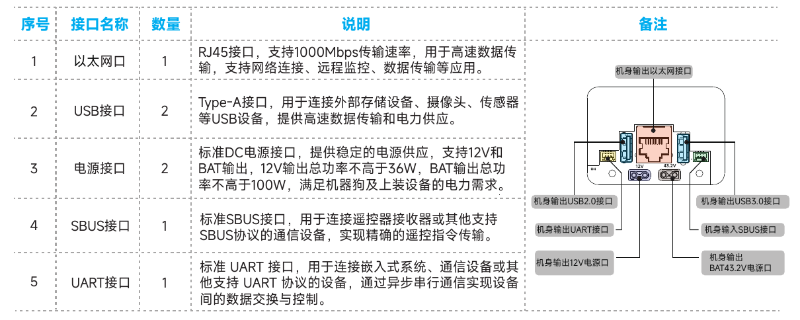

# 二次开发硬件接口说明

[返回首页](../index.md) | [硬件、软件与结构架构](./03-system-architecture.md) | [SDK 软件服务接口](./06-sdk-service-interfaces.md)

## 适用范围

本页说明机器人本体用于二次开发的外部接口及已公开的供电参数。

软件通信和控制程序请查看[硬件、软件与结构架构](./03-system-architecture.md)及[SDK 软件服务接口](./06-sdk-service-interfaces.md)。

结构设计资料见[钢镚L1 尺寸与安装参考](./03-system-architecture.md#dimensions)和[负载设计参考与模型下载](./03-system-architecture.md#payload-model-downloads)。

## 机身拓展接口

本体顶部拓展区提供网络、USB、电源和串行通信接口，可用于连接开发电脑、嵌入式计算平台、相机、传感器或遥控接收机。

| 接口 | 数量 | 主要用途或参数 |
| --- | ---: | --- |
| 千兆 RJ45 以太网 | 1 | 网络连接、远程监控和数据传输 |
| Type-A USB | 2 | 连接 USB 外部设备 |
| 12 V 电源 | 1 | 输出总功率不高于 36 W |
| BAT 43.2 V 电源 | 1 | 输出总功率不高于 100 W |
| SBUS | 1 | 连接 SBUS 设备 |
| UART | 1 | 异步串行通信 |

## 电源接口

### 12 V 输出

12 V 接口用于给拓展计算平台、传感器或通信设备供电，总功率不高于 36 W。

### BAT 43.2 V 输出

BAT 接口输出标称电压为 43.2 V，总功率不高于 100 W。

## 网络接口

千兆 RJ45 以太网接口可用于网络连接、远程监控和数据传输。

## USB 接口

机身提供两个 Type-A USB 接口，用于连接 USB 外部设备。

## 串行接口

### SBUS

机身提供 1 个 SBUS 接口。

### UART

机身提供 1 个标准 UART 接口，用于异步串行通信。接线时应使用与当前设备配套的接口定义确认针脚、电平和通信参数。
