# 设备操作、遥控器与 App 使用说明

[返回首页](../index.md)

## 安全说明

### 开发前检查

- 在平整、防滑、空旷的区域测试，清除周围人员、线缆和易损物品
- 检查腿部、轮胎或足底、电池、拓展设备和线缆是否安装牢固
- 确认机器狗电量充足，操作者熟悉遥控器的紧急停止和阻尼切换方式
- 第一次只测试状态读取、站立、趴下和小幅度移动
- 软件失去响应时应由现场人员使用实体控制手段接管，不要只依赖远程程序

程序中的 `CMD_EMERGENCY_STOP` 是软件急停。现场测试时应保留遥控器接管方式。

### 运动与特技风险

- 不要在人员附近或没有保护措施时测试跳跃、后空翻、双腿站立等动作
- 狂暴模式和特技动作会提高运动性能并增加关节负荷，长时间运行可能加速磨损
- 不要超出正常载荷、坡度和楼梯高度；极限参数仅用于理解能力边界
- 设备出现异常声音、异味、冒烟、失控、红灯闪烁或关节温度过高时，应立即停止运行并断开电源

### 尾灯状态

| 灯光 | 含义 | 建议处理 |
| --- | --- | --- |
| 蓝色常亮 | 开机完成 | 可进行连接和状态检查 |
| 蓝色闪烁 | 开机中 | 等待启动完成，不要发送运动命令 |
| 白色常亮 | 狂暴模式 | 保持安全距离，谨慎操作 |
| 绿色常亮 | 追踪模式开启 | 确认目标和周围环境安全 |
| 黄灯常亮 | 电量低于 20% | 结束高负载动作并准备充电 |
| 黄灯闪烁 | 电量低于 5% | 立即停止运动并充电 |
| 红灯常亮 | 关节温度过高 | 停机冷却并检查负载 |
| 红灯闪烁 | 系统异常 | 停止使用并联系售后 |

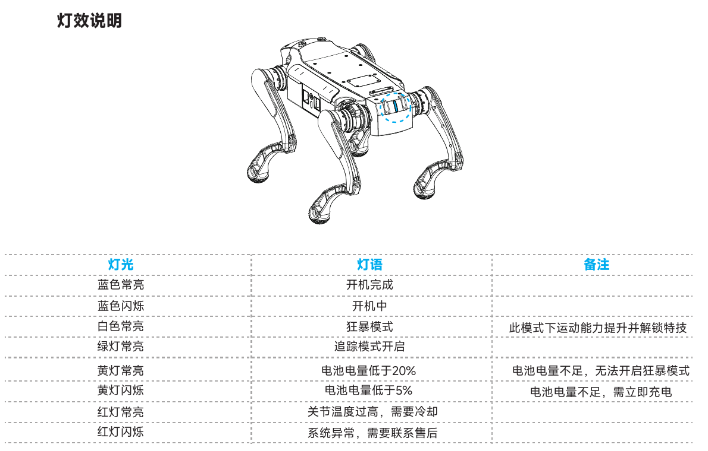

### 电池与充电

- 禁止拆卸电池或以任何方式引出电芯使用
- 只使用官方电池、充电座和电源适配器
- 不要使用酒精或其他可燃溶剂清洁适配器
- 电池泄漏进入眼睛时不要揉擦，应立即用清水冲洗并就医
- 充电出现异味、冒烟、变形或异常发热时，立即拔掉适配器并停止使用
- 电池充电时间不应超过 24 小时；不要把电池投入火中、加热、挤压或切割

### 环境与接口

- 产品工作温度为 0-40℃，防护等级为 IP54；不要将设备浸水或在积水中运行
- 连接上装前核对电源电压、极性和总功率，关闭设备后再插拔接口
- 不要让松动线缆进入腿部或轮毂运动范围

## 开机、充电与关机

### 电源位置

电池从机身侧面的电池仓插入。电池面板中央是电源键，下方 4 个 LED 用于显示剩余电量。

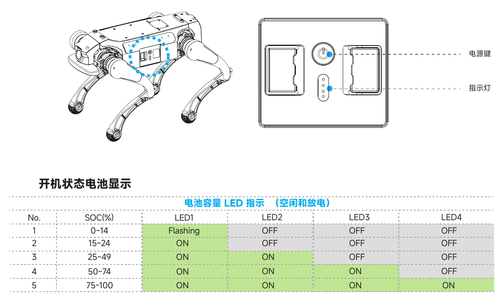

### 首次开机

1. 把机器狗从包装箱中取出，放在平整、防滑、空旷的地面上
2. 检查腿部周围没有人员、线缆或其他障碍物
3. 将电池完全插入机身电池仓，确认安装到位
4. 短按电池电源键1次
5. 再长按电源键 5 秒
6. 松开按键，等待约 20 秒
7. 尾灯蓝色常亮表示开机完成；蓝色闪烁时仍在开机，不要发送运动指令

### 电量指示

| 电量 | LED 状态 |
| --- | --- |
| 0-14% | LED1 闪烁 |
| 15-24% | LED1 常亮 |
| 25-49% | LED1、LED2 常亮 |
| 50-74% | LED1-LED3 常亮 |
| 75-100% | LED1-LED4 常亮 |

充电时，当前区间对应的 LED 会闪烁；4 个 LED 全部常亮表示充满。

### 充电

1. 确认机器人已停止运动，并取出电池
2. 先把充电线插头接到充电座底部接口
3. 确认连接牢固后，再把电源适配器接入 100-240 V 市电
4. 将电池放入充电座；指示灯亮起后开始充电
5. 充满后先断开市电，再取出电池

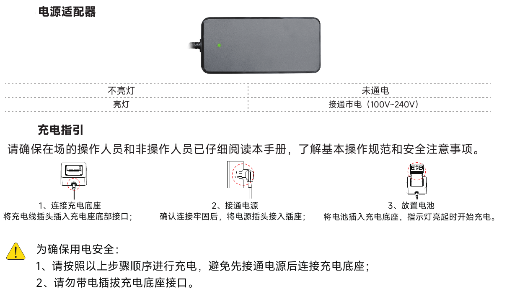

### 关机

1. 在实体遥控器或程序中停止移动，使机器人进入稳定趴下状态
2. 现场人员确认四肢不再运动后再靠近设备
3. 短按电池电源键1次，再长按电池电源键 5 秒关闭电源，等待尾灯和电池指示灯熄灭
4. 长时间存放或运输前取出电池

## 带屏遥控器操作指南

带屏遥控器同时提供实体摇杆、方向键、功能键和触摸屏应用。它适合现场接管、基础动作测试、状态查看和视频画面操作。开发 SDK 前，建议先用遥控器确认机器人能够正常开机、连接、站立和趴下。

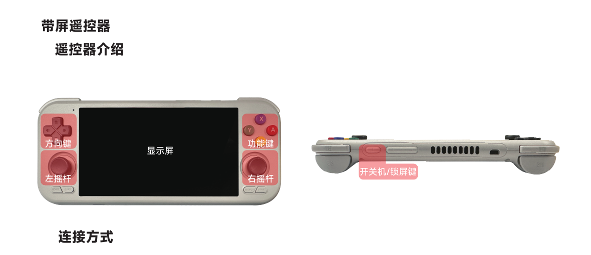

### 开机并进入控制应用

1. 长按遥控器上方的开机/锁屏键，等待系统启动
2. 在桌面点击 `Dog Controller` 进入应用
3. 应用主页右上角显示“未连接”时，先不要操作摇杆或动作按钮

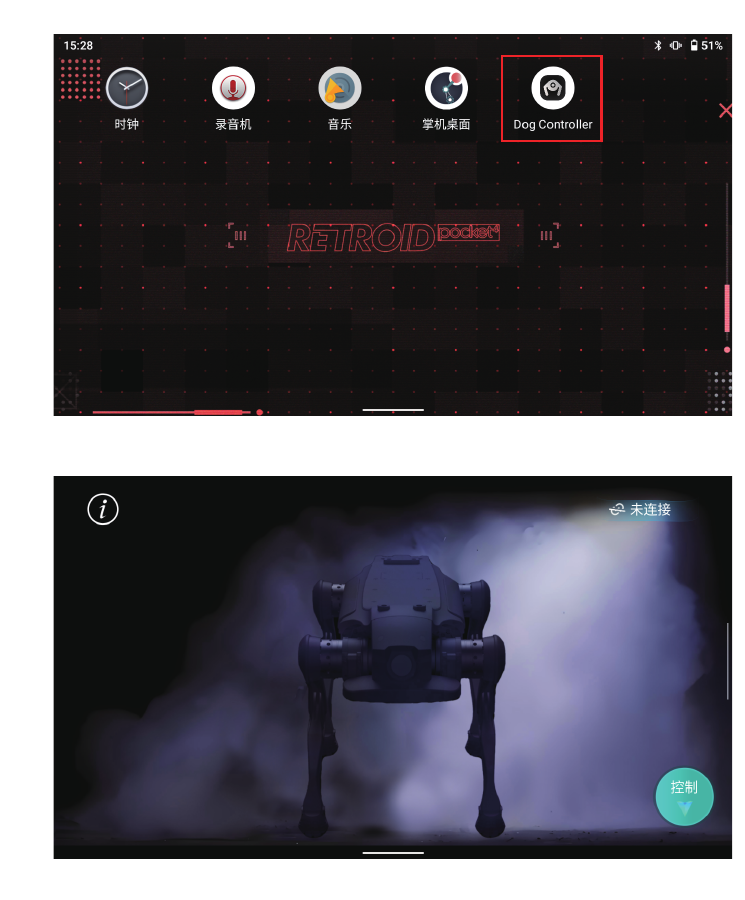

### 连接机器人

1. 确认机器人已经开机，尾灯蓝色常亮
2. 在应用主页点击右上角“未连接”
3. 在 WLAN 页面选择机器人热点，并按提示输入密码。首次连接可参照下文的[默认热点名称和密码](#连接机器狗-wi-fi)
4. 返回控制应用，右上角出现“已连接/热点名称”即表示连接成功

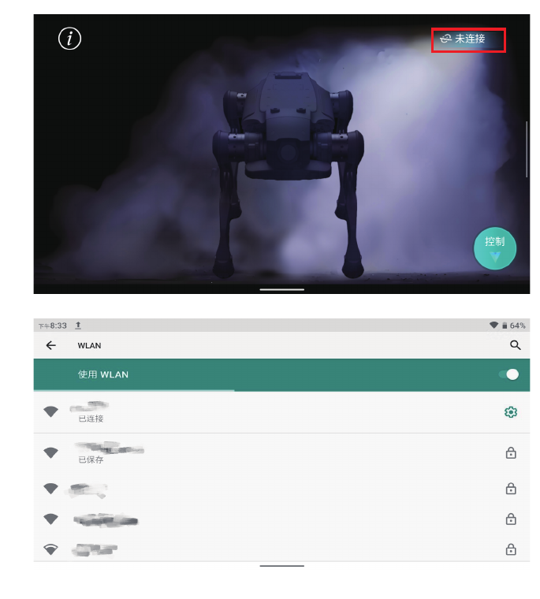

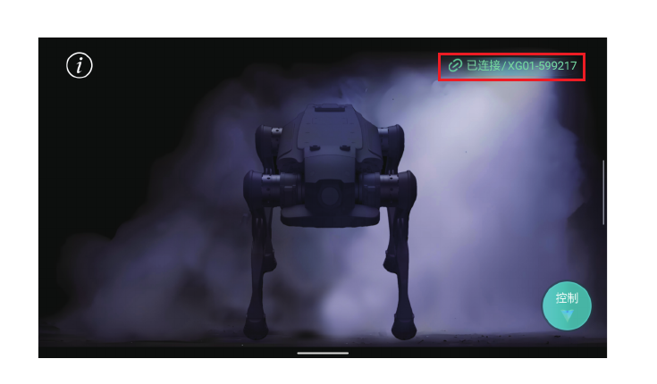

### 基础控制

点击主页右下角“控制”进入控制页面。连接成功后再进行以下操作：

- 使用屏幕动作按钮或实体按键切换阻尼、站立、俯卧、锁定和原地模式
- 使用左右摇杆或屏幕虚拟摇杆控制移动、转向和身形
- 从低速开始，确认方向正确后再切换中速或高速
- 红色“紧急停止”用于异常时立即停止运动；急停后先排除原因，不要直接恢复高速度动作

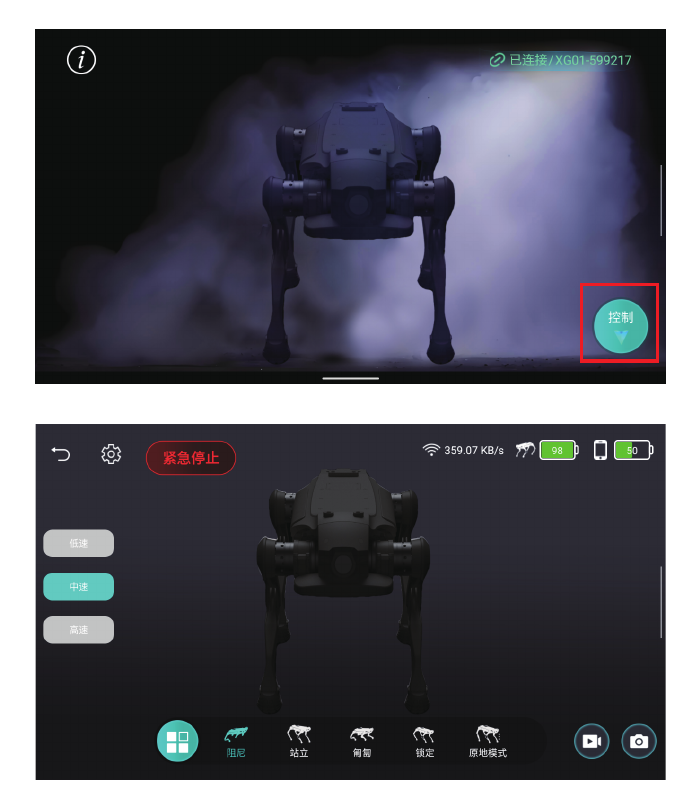

### 常规模式与狂暴模式

- **常规模式**：提供稳定的常规运动能力和标准动作，适合日常操作和开发前检查
- **狂暴模式**：提升运动性能，并在支持的机型上解锁更多特技动作，适合受控的科研或演示场景

## 连接机器狗 Wi-Fi

### 1. 在 Ubuntu 中连接设备热点

机器狗的默认 Wi-Fi 名称通常为 `XG01-XXXXXX`，其中 `XXXXXX` 为设备序列号（SN）的后六位。设备 SN 可在机器狗本体底部的标签上查看。默认初始密码统一为 `12345678`。

在开发电脑的 Wi-Fi 列表中选择对应热点，并输入密码。

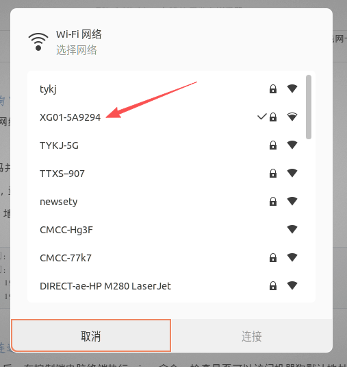

### 2. 查看开发电脑的 IPv4 地址

连接热点后，在终端执行以下命令，查看无线网卡的 IPv4 地址：

```bash
ip addr
```

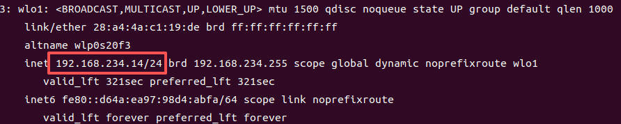

### 3. 检查与机器狗的网络连通性

机器狗 Wi-Fi 默认地址为 `192.168.234.1`。在终端执行：

```bash
ping -c 4 192.168.234.1
```

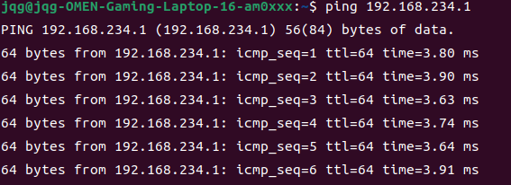

`ping` 成功只能证明 IP 网络可达，不代表 SDK 已经收到 UDP 状态数据。SDK 连接状态应使用 `IsConnected()` 判断。

## SSH 登录

SSH 用于从开发电脑进入机器狗内部 Linux 系统，适合状态检查和故障排查。在外接 Ubuntu 电脑上可直接运行 HighLevel 示例。

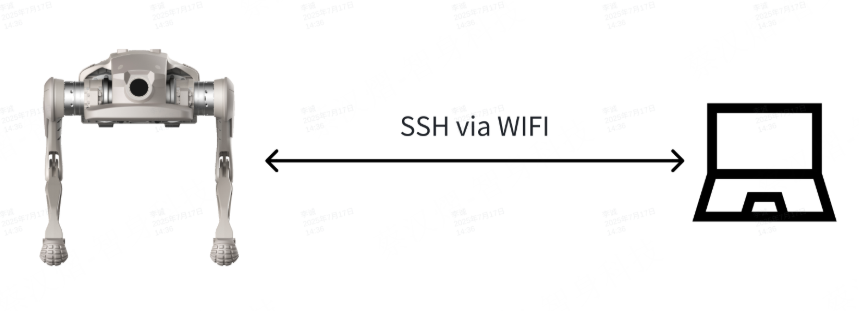

```bash
ssh firefly@192.168.234.1
```

第一次连接时输入 `yes`。如果设备仍使用出厂账号，密码通常为 `firefly`。

退出远程终端：

```bash
exit
```

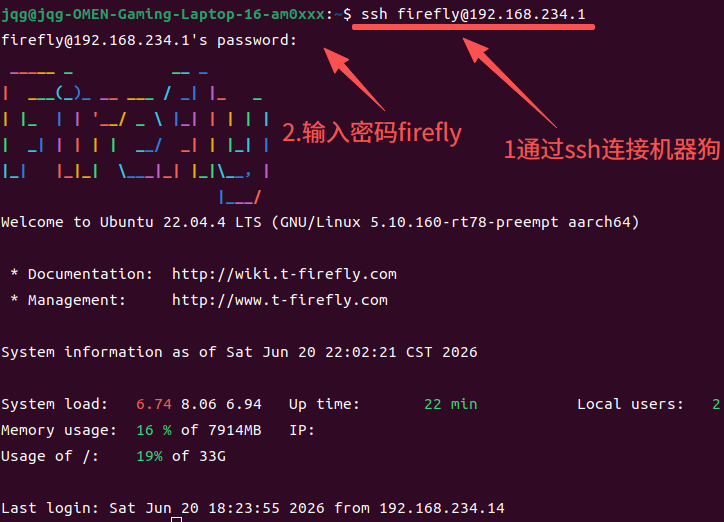
