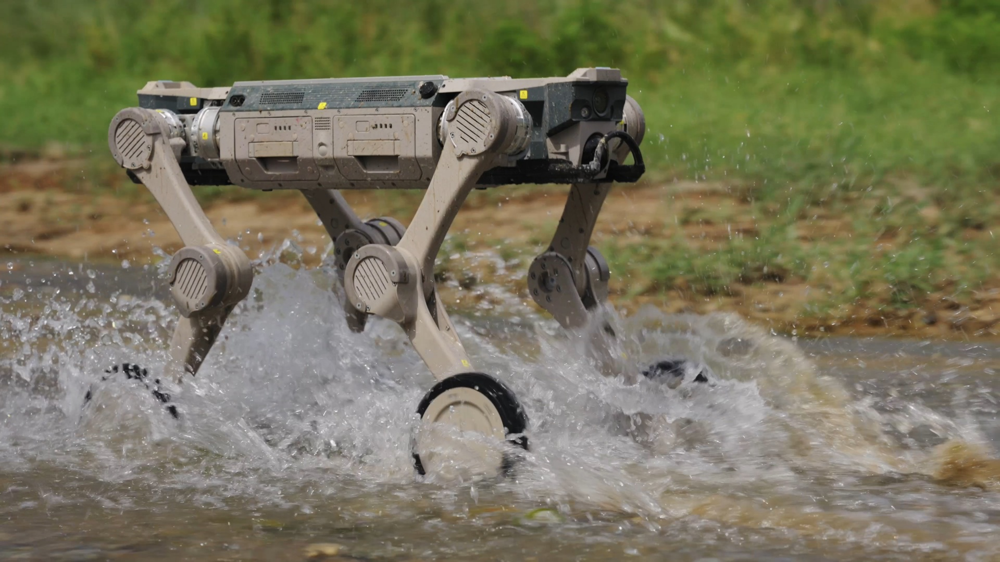

# 智身钢镚M1 SDK 开发文档

## 文档说明

本文档面向铜锤 M1 系列机器人的设备使用、应用开发和现场联调，内容包括产品规格、设备操作、系统组成、硬件接口、SDK 编译运行、控制流程、接口、数据类型、示例程序和故障排查。

M1 SDK 的核心类是 `robot_sdk::SDKClient`。应用程序通过 `SDKClient` 连接机器人、发送控制命令，并通过回调接收状态、故障和命令应答。

## 文档目录

| 章节 | 主要内容 | 阅读建议 |
| --- | --- | --- |
| [1. M1 产品介绍与规格](./md/01-product-introduction-and-specifications.md) | M1 系列各版本的外观、参数、传感器和软件能力 | 选型或初次了解产品时阅读 |
| [2. M1 设备使用与维护](./md/02-operation-and-maintenance.md) | 使用准备、开关机、遥控器、运动模式、安全保护、换电、充电和维护 | 首次操作设备前阅读 |
| [3. M1 系统组成与硬件接口](./md/03-system-components-and-hardware-interfaces.md) | 系统模块、网络结构、通信端口、扩展仓和视频接口 | 接入网络或安装上装设备前阅读 |
| [4. M1 SDK 快速开始](./md/04-sdk-quickstart.md) | 开发环境、SDK 目录、连接、编译、运行和自定义工程 | 第一次运行 SDK 时阅读 |
| [5. M1 SDK 控制流程与任务机制](./md/05-sdk-control-flow-and-task-handling.md) | 调用结果层级、同步与异步、控制权、回充和状态切换 | 编写正式控制程序前阅读 |
| [6. M1 SDK 接口参考](./md/06-sdk-api-reference.md) | `SDKClient` 的函数原型、参数、返回值和应答 | 编码时按功能查询 |
| [7. M1 回调、数据类型与状态参考](./md/07-callbacks-data-types-and-status-reference.md) | 回调接口、结构体、枚举、传感器数据和机器人状态 | 处理上报数据和命令应答时查询 |
| [8. M1 示例程序与故障排查](./md/08-examples-and-troubleshooting.md) | 官方示例用途、运行要点、常见问题和退出流程 | 联调、验证和排查问题时阅读 |

## 开发环境与通信

| 项目 | 版本或配置 |
| --- | --- |
| 编程语言 | C++ |
| 编译环境 | Ubuntu 22.04、GCC 11.4、CMake 3.8+ |
| 依赖库 | Boost 1.74 |
| 默认传输方式 | UDP |
| 默认 UDP 端口 | `8082` |
| WebSocket 端口 | `8081` |

## 使用前提

- 确认机器人型号、系统版本和 SDK 版本匹配。
- 确认机器人处于安全、空旷、无人员靠近的测试环境。
- 运动控制前先完成连接、握手和控制权确认。
- 命令发送成功不等于动作已经完成，动作状态需要通过状态数据和回调确认。
- 回调函数只做轻量处理，耗时任务放到应用自己的工作线程中。
- 软件急停不能代替现场人员可操作的硬急停。
