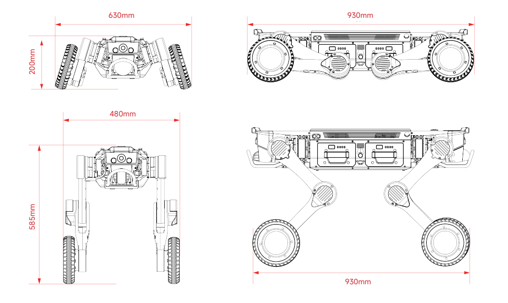

# M1 产品介绍与规格

[返回文档总览](../index.md) | [设备使用与维护](./02-operation-and-maintenance.md) | [系统组成、硬件接口与结构设计资料](./03-system-components-and-hardware-interfaces.md)

## 产品概述

铜锤 M1 是一款轮足式仿生四足机器人，具备自重轻、负载大、续航长、防护强、运动灵活稳定等特点；机器狗每条腿配备 3 个关节电机和 1 个轮毂电机，配备激光雷达、光学相机、超声波雷达、IMU、RTK 模块等感知设备，并配置补光灯。内部搭载高算力主控平台，用于实现运动控制、自主导航定位、环境侦检等功能，提供丰富的供电和通信接口，支持多品类任务载荷扩展。

进行上装设计时，可结合外形尺寸图和上装空间示意图核对布置空间，再查阅负载能力设计参考。相关 PDF、CAD 外观模型和 URDF 模型可在第 3 章的[负载设计参考与模型下载](./03-system-components-and-hardware-interfaces.md#payload-model-downloads)中获取。

## 产品规格

<table border="1" cellspacing="0" cellpadding="8" style="border-collapse: collapse; width: 100%;">
  <thead>
    <tr style="background-color: #f2f4f7; text-align: center;">
      <th>分类</th>
      <th>参数</th>
      <th>铜锤 M1</th>
      <th>铜锤 M1（智航 Pro 版）</th>
      <th>铜锤 M1 Pro</th>
      <th>铜锤 M1 Ultra</th>
    </tr>
  </thead>
  <tbody>
    <tr>
      <td rowspan="9"><strong>基础信息</strong></td>
      <td>材质</td>
      <td>铝合金 + 高强度工程塑料</td>
      <td>铝合金 + 高强度工程塑料</td>
      <td>铝合金 + 高强度工程塑料</td>
      <td>铝合金 + 高强度工程塑料</td>
    </tr>
    <tr>
      <td>站立尺寸（长 &#215; 宽 &#215; 高）</td>
      <td>930 &#215; 480 &#215; 585 mm</td>
      <td>930 &#215; 480 &#215; 585 mm</td>
      <td>930 &#215; 480 &#215; 595 mm</td>
      <td>930 &#215; 480 &#215; 595 mm</td>
    </tr>
    <tr>
      <td>趴地尺寸（长 &#215; 宽 &#215; 高）</td>
      <td>930 &#215; 630 &#215; 200 mm</td>
      <td>930 &#215; 630 &#215; 200 mm</td>
      <td>930 &#215; 630 &#215; 210 mm</td>
      <td>930 &#215; 630 &#215; 210 mm</td>
    </tr>
    <tr>
      <td>整机重量（含电池）</td>
      <td>41 kg</td>
      <td>41 kg</td>
      <td>41 kg</td>
      <td>41 kg</td>
    </tr>
    <tr>
      <td>工作温度</td>
      <td>-20℃ 至 55℃</td>
      <td>-20℃ 至 55℃</td>
      <td>-20℃ 至 55℃</td>
      <td>-20℃ 至 55℃</td>
    </tr>
    <tr>
      <td>防护等级</td>
      <td>IP67</td>
      <td>IP67</td>
      <td>IP67</td>
      <td>IP67</td>
    </tr>
    <tr>
      <td>充电时长</td>
      <td>＜2 h</td>
      <td>＜2 h</td>
      <td>＜2 h</td>
      <td>＜2 h</td>
    </tr>
    <tr>
      <td>续航里程</td>
      <td>空载 29 km / 满载 18 km</td>
      <td>空载 29 km / 满载 18 km</td>
      <td>空载 29 km / 满载 18 km</td>
      <td>空载 29 km / 满载 18 km</td>
    </tr>
    <tr>
      <td>续航时间</td>
      <td>空载 5.5 h / 满载 3.5 h</td>
      <td>空载 5.5 h / 满载 3.5 h</td>
      <td>空载 5.5 h / 满载 3.5 h</td>
      <td>空载 5.5 h / 满载 3.5 h</td>
    </tr>
    <tr>
      <td rowspan="8"><strong>性能参数</strong></td>
      <td>标配算力</td>
      <td>8 核高性能 CPU</td>
      <td>8 核高性能 CPU</td>
      <td>8 核高性能 CPU</td>
      <td>8 核高性能 CPU</td>
    </tr>
    <tr>
      <td>扩展算力</td>
      <td>Jetson Orin NX 16G（100 TOPS）</td>
      <td>Jetson Orin NX 16G（100 TOPS）</td>
      <td>Jetson Orin NX 16G（100 TOPS）</td>
      <td>S100（128 TOPS）</td>
    </tr>
    <tr>
      <td>最大速度</td>
      <td>6 m/s</td>
      <td>6 m/s</td>
      <td>6 m/s</td>
      <td>6 m/s</td>
    </tr>
    <tr>
      <td>极限速度</td>
      <td>8 m/s</td>
      <td>8 m/s</td>
      <td>8 m/s</td>
      <td>8 m/s</td>
    </tr>
    <tr>
      <td>工作负载</td>
      <td>30 kg</td>
      <td>30 kg</td>
      <td>30 kg</td>
      <td>30 kg</td>
    </tr>
    <tr>
      <td>连续攀爬楼梯高度</td>
      <td>25 cm</td>
      <td>25 cm</td>
      <td>25 cm</td>
      <td>25 cm</td>
    </tr>
    <tr>
      <td>最大攀爬落差高度</td>
      <td>80 cm</td>
      <td>80 cm</td>
      <td>80 cm</td>
      <td>80 cm</td>
    </tr>
    <tr>
      <td>最大爬坡角度</td>
      <td>45&#176;</td>
      <td>45&#176;</td>
      <td>45&#176;</td>
      <td>45&#176;</td>
    </tr>
    <tr>
      <td rowspan="6"><strong>关节参数</strong></td>
      <td>执行器类型</td>
      <td>高功率密度运动单元</td>
      <td>高功率密度运动单元</td>
      <td>高功率密度运动单元</td>
      <td>高功率密度运动单元</td>
    </tr>
    <tr>
      <td>最大关节扭矩</td>
      <td>220 N&#183;m，毫秒级响应</td>
      <td>220 N&#183;m，毫秒级响应</td>
      <td>220 N&#183;m，毫秒级响应</td>
      <td>220 N&#183;m，毫秒级响应</td>
    </tr>
    <tr>
      <td>铝合金精密关节电机</td>
      <td>12 个</td>
      <td>12 个</td>
      <td>12 个</td>
      <td>12 个</td>
    </tr>
    <tr>
      <td>高性能轮毂电机</td>
      <td>4 个</td>
      <td>4 个</td>
      <td>4 个</td>
      <td>4 个</td>
    </tr>
    <tr>
      <td>关节运动空间（机身）</td>
      <td>-30&#176; 至 40&#176;</td>
      <td>-30&#176; 至 40&#176;</td>
      <td>-30&#176; 至 40&#176;</td>
      <td>-30&#176; 至 40&#176;</td>
    </tr>
    <tr>
      <td>关节运动空间（大腿 / 小腿）</td>
      <td>大腿：&#177;140&#176; / 小腿：&#177;160&#176;</td>
      <td>大腿：&#177;140&#176; / 小腿：&#177;160&#176;</td>
      <td>大腿：&#177;140&#176; / 小腿：&#177;160&#176;</td>
      <td>大腿：&#177;140&#176; / 小腿：&#177;160&#176;</td>
    </tr>
    <tr>
      <td rowspan="7"><strong>感知能力</strong></td>
      <td>相机类型</td>
      <td>广角相机 &#215;2</td>
      <td>广角相机 &#215;2</td>
      <td>广角相机 &#215;2</td>
      <td>鱼眼相机 &#215;4 + 前后双目相机 &#215;2</td>
    </tr>
    <tr>
      <td>相机像素</td>
      <td>800 万 &#215;2（DFOV 122&#176;）</td>
      <td>800 万 &#215;2（DFOV 122&#176;）</td>
      <td>800 万 &#215;2（DFOV 122&#176;）</td>
      <td>鱼眼 300 万 + 双目 200 万</td>
    </tr>
    <tr>
      <td>车规级 IMU</td>
      <td>&#215;1</td>
      <td>&#215;1</td>
      <td>&#215;1</td>
      <td>&#215;1</td>
    </tr>
    <tr>
      <td>3D 激光雷达</td>
      <td>&#215;2</td>
      <td>&#215;2</td>
      <td>&#215;2</td>
      <td>&#215;2</td>
    </tr>
    <tr>
      <td>深度相机</td>
      <td>/</td>
      <td>/</td>
      <td>/</td>
      <td>标配</td>
    </tr>
    <tr>
      <td>RTK 定位模块</td>
      <td>&#215;1</td>
      <td>&#215;1</td>
      <td>&#215;1</td>
      <td>&#215;1</td>
    </tr>
    <tr>
      <td>超声波传感器</td>
      <td>&#215;2</td>
      <td>&#215;2</td>
      <td>&#215;2</td>
      <td>&#215;2</td>
    </tr>
    <tr>
      <td rowspan="4"><strong>通信与交互</strong></td>
      <td>WiFi / 蓝牙</td>
      <td>标配</td>
      <td>标配</td>
      <td>标配</td>
      <td>标配</td>
    </tr>
    <tr>
      <td>UWB</td>
      <td>/</td>
      <td>/</td>
      <td>标配</td>
      <td>标配</td>
    </tr>
    <tr>
      <td>麦克风 / 扬声器</td>
      <td>/</td>
      <td>/</td>
      <td>标配</td>
      <td>标配</td>
    </tr>
    <tr>
      <td>功能拓展接口</td>
      <td>千兆网口 &#215;2、USB 3.0 &#215;2、RS232 &#215;1、RS485 &#215;1、SBUS &#215;2、PPS &#215;1</td>
      <td>千兆网口 &#215;2、USB 3.0 &#215;2、RS232 &#215;1、RS485 &#215;1、SBUS &#215;2、PPS &#215;1</td>
      <td>千兆网口 &#215;2、USB 3.0 &#215;2、RS232 &#215;1、RS485 &#215;1、SBUS &#215;2、PPS &#215;1</td>
      <td>千兆网口 &#215;2、USB 3.0 &#215;2、RS232 &#215;1、RS485 &#215;1、SBUS &#215;2、PPS &#215;1</td>
    </tr>
    <tr>
      <td rowspan="7"><strong>系统与软件能力</strong></td>
      <td>标准动作</td>
      <td>支持踏步、滑行、匍匐等姿态；前后左右直线移动、原地旋转；膝关节姿态变换；支持砂石路、柏油路、草地、沙地、森林地面、建筑废墟等路面</td>
      <td>支持踏步、滑行、匍匐等姿态；前后左右直线移动、原地旋转；膝关节姿态变换；支持砂石路、柏油路、草地、沙地、森林地面、建筑废墟等路面</td>
      <td>支持踏步、滑行、匍匐等姿态；前后左右直线移动、原地旋转；膝关节姿态变换；支持砂石路、柏油路、草地、沙地、森林地面、建筑废墟等路面</td>
      <td>支持踏步、滑行、匍匐等姿态；前后左右直线移动、原地旋转；膝关节姿态变换；支持砂石路、柏油路、草地、沙地、森林地面、建筑废墟等路面</td>
    </tr>
    <tr>
      <td>特技动作</td>
      <td>爬高墙、过挡鼠板、过窄墙、扭一扭等</td>
      <td>爬高墙、过挡鼠板、过窄墙、扭一扭等</td>
      <td>爬高墙、过挡鼠板、过窄墙、扭一扭等</td>
      <td>爬高墙、过挡鼠板、过窄墙、扭一扭等</td>
    </tr>
    <tr>
      <td>实时图像传输</td>
      <td>支持</td>
      <td>支持</td>
      <td>支持</td>
      <td>支持</td>
    </tr>
    <tr>
      <td>OTA 升级</td>
      <td>支持</td>
      <td>支持</td>
      <td>支持</td>
      <td>支持</td>
    </tr>
    <tr>
      <td>二次开发</td>
      <td>支持</td>
      <td>支持</td>
      <td>支持</td>
      <td>支持</td>
    </tr>
    <tr>
      <td>自主导航</td>
      <td>支持（二开）</td>
      <td>标配</td>
      <td>支持（二开）</td>
      <td>标配</td>
    </tr>
    <tr>
      <td>智能避障</td>
      <td>支持（二开）</td>
      <td>标配</td>
      <td>支持（二开）</td>
      <td>标配</td>
    </tr>
    <tr>
      <td rowspan="6"><strong>配件</strong></td>
      <td>电池</td>
      <td>18.7 Ah / 1010 Wh（双电池，支持快拆快换、热插拔）</td>
      <td>18.7 Ah / 1010 Wh（双电池，支持快拆快换、热插拔）</td>
      <td>18.7 Ah / 1010 Wh（双电池，支持快拆快换、热插拔）</td>
      <td>18.7 Ah / 1010 Wh（双电池，支持快拆快换、热插拔）</td>
    </tr>
    <tr>
      <td>适配器、充电座</td>
      <td>标配</td>
      <td>标配</td>
      <td>标配</td>
      <td>标配</td>
    </tr>
    <tr>
      <td>遥控器</td>
      <td>航模遥控器</td>
      <td>航模遥控器</td>
      <td>航模遥控器</td>
      <td>航模遥控器</td>
    </tr>
    <tr>
      <td>航空箱</td>
      <td>标配</td>
      <td>标配</td>
      <td>标配</td>
      <td>标配</td>
    </tr>
    <tr>
      <td>存储单元</td>
      <td>标配 256G SSD</td>
      <td>标配 256G SSD</td>
      <td>标配 256G SSD + 512G TF 卡</td>
      <td>标配 256G SSD + 512G TF 卡</td>
    </tr>
    <tr>
      <td>充电桩（包含自主回充功能）</td>
      <td>可选配</td>
      <td>可选配</td>
      <td>可选配</td>
      <td>可选配</td>
    </tr>
  </tbody>
</table>

## 参数说明

- 续航时间为速度 1 m/s、无负载工况下的实验室测试数据。
- 极限速度为无负载、平坦路面条件下的实验室测试数据，实际速度会随负载、地形和温度变化。
- 功能和配件以实际交付配置为准。自主导航、智能避障、跟随、语音及存储能力应根据具体型号确认。
