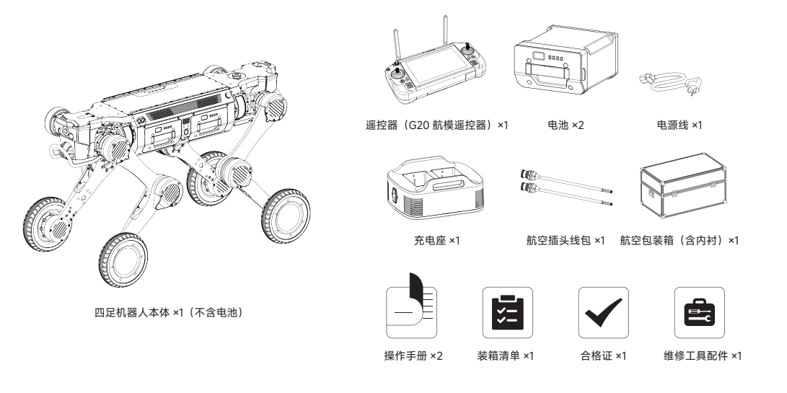
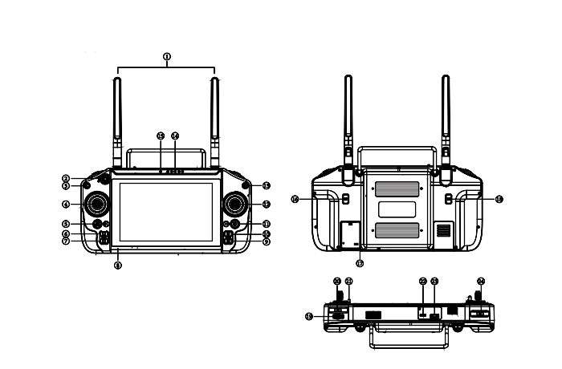
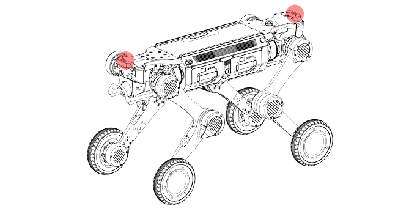

# M1 设备使用与维护

[返回文档总览](../index.md) | [产品介绍与规格](./01-product-introduction-and-specifications.md) | [系统组成、硬件接口与结构设计资料](./03-system-components-and-hardware-interfaces.md)

## 使用前准备

### 标准装箱组成

开箱后应核对机器人本体、G20 航模遥控器、两块电池、电源线、充电座、航空插头线包、航空包装箱、操作手册、装箱清单、合格证和维保工具配件。发现外观损伤、数量不符或接口变形时，不要开机或充电。

### 使用环境

- 操作人员应完成设备操作培训，并在使用前熟读操作手册和警示内容。
- 工作温度：-20℃ 至 55℃。
- 充电环境：0℃ 至 50℃，保持干燥、通风并远离易燃物。
- 设备运行前应清除周围人员、线缆和障碍物。
- 楼梯、坡道和高台作业时，不要站在机器人正上方、正下方或运动轨迹上。
- 操作期间保持机器人处于视线范围内。机器人静止时，人员与设备距离不得小于 2 m；机器人移动或执行作业任务时，距离不得小于 3 m。
- 禁止在爆炸性、腐蚀性或高粉尘环境中开机和运行设备。
- IP67 不代表可以在所有水下环境长期运行；接口盖、电池仓和外壳必须完整、干燥。

### 开机前检查

1. 检查机身、防撞梁、腿部连杆和轮足是否存在裂纹、变形、松动或严重磨损。
2. 检查电池外壳、端子和卡扣，确认没有鼓包、漏液、破损、异常发热和异物。
3. 检查激光雷达、相机和超声波传感器表面，去除保护膜和遮挡物。
4. 确认电池安装到位，电池外壳与机身表面齐平，拉带不能自由晃动。
5. 确认硬急停已经解除。
6. 将机器人水平趴放，腹部贴地，腿部自然放在机身两侧。
7. 确认遥控器电量充足并处于机器人附近。

## 启动与基本操作

### 电池安装与开机

M1 使用两块可拆卸电池，支持单电池供电、双电池供电和热插拔换电。

#### 安装电池

1. 确认电池接口和电池仓内没有灰尘、水分或异物。
2. 对准电池仓接口，将电池沿导向推入。
3. 推到底后松开拉带，听到卡扣锁紧声。
4. 检查电池外壳与机身表面齐平，拉带不能自由晃动。

#### 机器狗开机

1. 短按电池按键，激活电池并查看电量。
2. 长按电池按键约 3 s，电池开启，机器狗开始启动。
3. 状态灯白色频闪表示启动中，白色常亮表示启动完成。
4. 启动完成后，机器人进入通用运动模式。

双电池支持互相唤醒。不要使用变形、漏液、过热或端子损坏的电池，不要拆解、撞击、挤压、刺穿或短接电池。

### G20 航模遥控器

#### 连接与启动

1. 将遥控器置于机器人附近，并确认机器人周围没有人员和障碍物。
2. 启动机器人，等待机器人完成开机。
3. 长按遥控器电源键约 3 s。遥控器与机器人出厂前已完成一对一匹配，启动后会自动连接。
4. 打开 `GenisDog` App，进入控制界面并确认设备连接及健康状态。

#### 按键与接口

| 编号 | 按键或接口 | 编号 | 按键或接口 |
| ---: | --- | ---: | --- |
| ① | 2.4G / 5.8G 天线 | ⑬ | 软急停按键 |
| ② | 未定义 | ⑭ | 遥控器电量指示灯 |
| ③ | 返回按键 | ⑮ | 对频指示灯 |
| ④ | 左摇杆 | ⑯ | B2 按键 |
| ⑤ | H 按键 | ⑰ | SIM 卡插口 |
| ⑥ | L1 按键 | ⑱ | B1 按键 |
| ⑦ | L2 按键 | ⑲ | 波轮 |
| ⑧ | 麦克风 | ⑳ | 补光灯按键 |
| ⑨ | R2 按键 | ㉑ | 挂绳处 |
| ⑩ | R1 按键 | ㉒ | Type-C 接口 |
| ⑪ | 电源键 | ㉓ | USB 接口 |
| ⑫ | 右摇杆 | ㉔ | 拍摄 / 录像按键 |

#### 常用操作

| 操作 | 功能 |
| --- | --- |
| 返回按键 | 返回上一层页面 |
| 左摇杆 | 控制机器人前后左右移动 |
| 右摇杆 | 控制原地转弯、左右探头和俯仰 |
| `H` + 右摇杆上下 | 调整高低身形 |
| `H` + 右摇杆左右 | 执行水平转身 |
| `L1` + `R1` | 切换机器狗头尾方向 |
| `L2` + `R2` | 切换膝关节姿态 |
| 软急停按键 | 停止当前运动 |
| 补光灯按键 | 循环切换补光灯组合 |
| 拍摄按键点按 | 拍照 |
| 拍摄按键长按 3 s | 开始录像 |
| 录像过程中再次点按拍摄按键 | 停止录像 |

### 运动模式

**原地模式：**机器人保持原地不动，可调整躯干旋转、俯仰和高低姿态。

**运动模式：**机器人可在复杂地形中移动，并执行当前设备配置支持的特技动作。

**巡航模式：**完成地图创建后，可基于地图执行定点巡航和作业。

运动模式通常提供低速、中速和高速档。速度提高后，左右平移和原地旋转等组合动作可能受到限制。

### 状态指示灯

| 指示灯颜色 | 灯效 | 机器人状态 |
| --- | --- | --- |
| 白灯 | 慢闪 | 开机中 |
| 白灯 | 常亮 | 手动控制或机器人工作状态 |
| 白灯 | 呼吸 | 待机 |
| 绿灯 | 慢闪 | 定位中或自动回程中 |
| 绿灯 | 常亮 | 自动任务执行中 |
| 黄灯 | 快闪 | 告警状态 |
| 黄灯 | 常亮 | 低电量 |
| 红灯 | 快闪 | 故障状态 |
| 红灯 | 常亮 | 软急停 |
| 蓝灯 | 常亮 | 升级中 |
| 不限颜色 | 呼吸 | 充电中 |

状态灯出现红色或黄色提示时，应先停止运动并检查 App 中的急停、故障和电量信息。解除急停或排除故障后，再确认状态灯恢复正常。

### 运行安全

- 中速和高速档会限制左右平移、原地旋转等组合动作，不要尝试绕过限制。
- 机器人最大速度可达 6 m/s，高速运行时必须远离人群。
- 爬高台时应保持机器人空载、电池电量不少于两格，并与周围人员保持 2 m 以上距离。

## 安全与保护

### 硬急停

出现失控、严重故障或人员进入危险区域时，拍下机身背部红色硬急停按键。硬急停触发后红灯常亮，机器人缓慢趴下并保持静止。确认原因和现场安全后，顺时针旋转按键解除硬急停。

### 软急停

按下遥控器软急停按键，机器人停止当前动作，App 同步显示提示。确认现场安全后，在 App 中解除软急停。软件急停和遥控器软急停不能替代机身硬急停。

### 过热保护

关节、主控或电池温度过高时，机器人会停止当前所有运动、自动趴下并保持不动。可在 App 中查看过热部位和温度；待温度恢复到正常范围后，再检查设备状态和故障提示。

### 低电量保护

两块电池电量均低于 20% 时进入低电量预警；均低于 10% 时触发低电量保护，机器人自动趴下并停止响应运动控制。应更换或充电后再使用。

### 摔倒保护

机器人摔倒后可能尝试恢复站立。恢复动作需要空间，周围至少应保持 2 m 安全范围；不要在硬急停未触发时拖拽摔倒的机器人。

## 换电、关机与充电

### 热插拔换电

1. 确认机器人处于稳定姿态，现场没有人员进入腿部运动范围。
2. 在双电池供电状态下拔出待更换电池。
3. 将已充电电池插入空出的电池仓并确认卡扣锁紧。
4. 检查两块电池状态和 App 电量显示。

### 关机

1. 通过遥控器 App 让机器人水平趴下。
2. 确认腿部完全贴地，机器人姿态稳定。
3. 长按电池侧面的电源键 3 s，直至电池指示灯熄灭。
4. 取出电池时先确认设备已经完全断电。

不要在站立姿态下直接断开唯一一块开机电池。

### 双电池充电座与充电

| 参数 | 数值 |
| --- | --- |
| 输入电压 | AC 220 V |
| 输出电压 | DC 63 V |
| 最大充电电流 | 10 A |
| 充电仓数量 | 2 个 |
| 充电环境 | 0℃ 至 50℃，干燥、通风、硬质平面 |

1. 机器人停止运动并关机后取出电池。
2. 将电池和充电设备放在 0℃ 至 50℃、干燥、通风的水平硬质平面上，不得放在地毯、沙发等易燃表面。
3. 确保电池和充电设备周围 1 m 内没有纸张、布料、酒精等易燃物，并远离明火和高温源。
4. 接通 220 V 交流电源，打开充电座电源开关。
5. 将电池对准充电仓接口插入，确认充电指示灯正常。
6. 单块或双电池充电时间均不得超过 2 h，任何情况下最长充电时间不得超过 6 h。
7. 充电器指示灯全部常亮后，应在 30 分钟内断开充电器与电池的连接，并关闭充电座。

只能使用原厂配套充电器和充电座。禁止使用第三方充电器或非标准电源，禁止长期插电过充。

### 异常处置

- 设备进水后，应立即关机、拔出电池并进行干燥处理。
- 设备冒烟或起火时，优先使用二氧化碳或干粉灭火器，禁止使用泡沫灭火器。
- 腿部摆动或运动失控时，先触发软急停；软急停无效时触发硬急停。设备停稳后关机并拔出电池，故障排除前不得重新启动。

## 日常维护

设备维护前必须关闭电源。使用后用干燥、干净的软布擦拭机身、相机和激光雷达，禁止使用酒精、消毒液等腐蚀性液体。

| 周期 | 检查与维护内容 |
| --- | --- |
| 每次使用前，约 5 分钟 | 检查机身和腿部连杆有无变形、裂纹；检查关节和足部固定螺丝；检查轮胎脱落或严重磨损；检查电池鼓包、漏液、端子异物和安装状态；电量低于 20% 时充电；测试关节动作、图传、传感器和 10 m 内遥控信号 |
| 每周 1 次，约 20 分钟 | 清洁机身、相机、激光雷达、传感器缝隙和轮胎缠绕物；清理关节表面及缝隙；涉水后用低温风吹干轴承区域；检查关节卡顿、异响、螺丝松动和线缆磨损 |
| 每月 1 次，约 30 分钟 | 检查并按提示更新固件，升级期间保持电量不低于 50% 且不得断电；清理机身缝隙积尘；检查轮胎、腿部和躯干连接螺丝；将电池放电至 30% 后充至 60%，并检查电池外观和电路端子 |

更换轮胎、电池等部件时使用原厂配件。关节卡死、传感器失灵、电池异常或线路损坏时不要自行拆解，应停止使用并联系技术支持。
