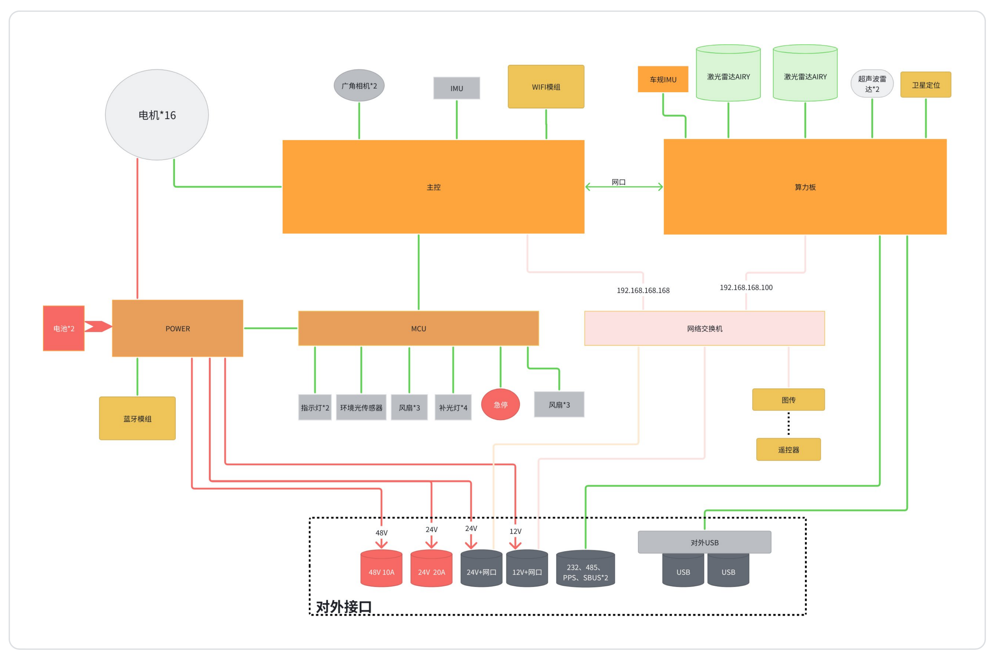
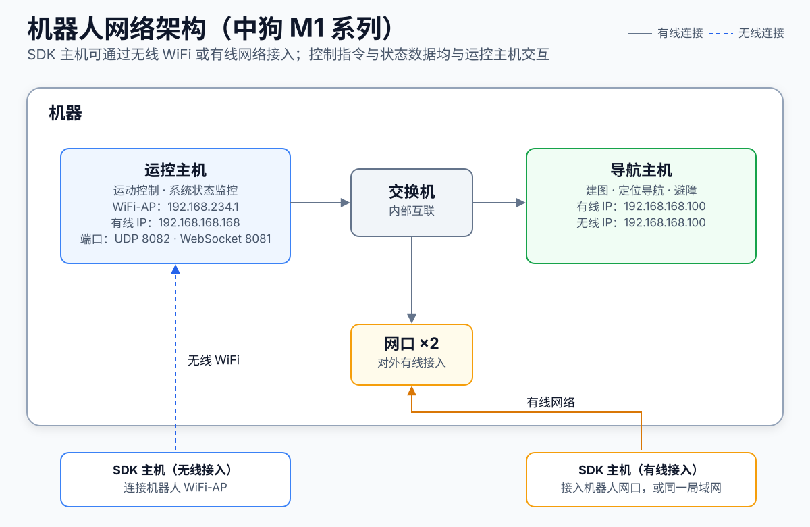
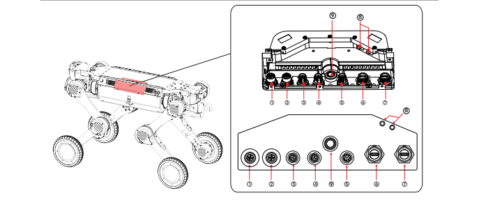

# M1 系统组成与硬件接口

[返回文档总览](../index.md) | [设备使用与维护](./02-operation-and-maintenance.md) | [M1 SDK 快速开始](./04-sdk-quickstart.md)

## 系统组成

M1 的系统主要由运控主机、导航主机、交换机、传感器、扩展仓和外部控制端组成：

### 硬件架构

下图展示主控、算力板、传感器、供电模块和对外接口之间的连接关系。

### 网络架构与组件

| 组件 | 主要职责 | 有线 IP | 无线 IP |
| --- | --- | --- | --- |
| 运控主机 | 运动控制、系统状态和 SDK 通信 | `192.168.168.168` | `192.168.234.1`（WiFi-AP） |
| 导航主机 | 建图、定位、导航和避障 | `192.168.168.100` | `192.168.168.100` |
| 交换机 | 连接运控主机、导航主机和外部网口 |  |  |
| 机器人外部网口 | 提供有线网络接入 | 由局域网分配 |  |
| SDK 开发主机 | 运行用户自己的 C++ 程序 | 与机器人处于同一网络 | 连接机器人 WiFi-AP |

## 网络结构与通信端口

开发主机可以通过机器人 WiFi-AP 或外部网口接入系统。运控主机的 WiFi-AP 地址为 `192.168.234.1`，有线地址为 `192.168.168.168`；导航主机的有线 IP 和无线 IP 均为 `192.168.168.100`。本节用于说明网络结构和端口用途，实际连接和测试步骤见 [M1 SDK 快速开始](./04-sdk-quickstart.md#连接机器人)。

| 设备 | 端口 | 协议 / 用途 |
| --- | ---: | --- |
| 机器狗 | 8081 | WebSocket / App 控制入口 |
| 机器狗 | 8082 | SDK 默认 UDP 连接端口 |
| 机器狗 | 8554 | RTSP 视频流 |

SDK 构造函数默认使用 `TransportProtocol::Udp`。如果使用 WebSocket，需要在构造 `SDKClient` 时指定协议，并连接 `8081` 端口。

## 扩展仓

扩展仓位于机器狗背部，用于安装载荷、连接供电和通信线缆。扩展仓电源按键可以单独控制扩展接口的供电。

| 序号 | 接口名称 | 数量或能力 |
| --- | --- | --- |
| ① | 48 V 电源 | 10 A × 1 |
| ② | 24 V 电源 | 20 A × 1 |
| ③ | 24 V + 网口 | 24 V / 3 A + 千兆网口 × 1 |
| ④ | 12 V + 网口 | 12 V / 5 A + 千兆网口 × 1 |
| ⑤ | 串口 | RS232 × 1、RS485 × 1、SBUS × 2、PPS × 1 |
| ⑥、⑦ | USB 3.0 | 5 V / 1 A，2 个 |
| ⑧ | RTK 天线接口 | 1 个 |
| ⑨ | 扩展仓电源按键 | 控制扩展接口供电 |

### 供电与防护

- 所有扩展供电接口的总功率不超过 480 W。
- 为保持 IP67，未使用的航空插头必须盖好防护盖。
- 执行爬高台特技时，机器人必须空载且电池电量不少于两格。

## 视频流

M1 提供 RTSP 视频流端口 `8554` 和 `8555`。具体流地址、前后相机对应关系和码率需要结合当前设备配置确认。SDK 自身提供 `UpdateCameraBitrate()` 用于调整相机码率，接口说明见 [M1 SDK 接口参考](./06-sdk-api-reference.md)。
