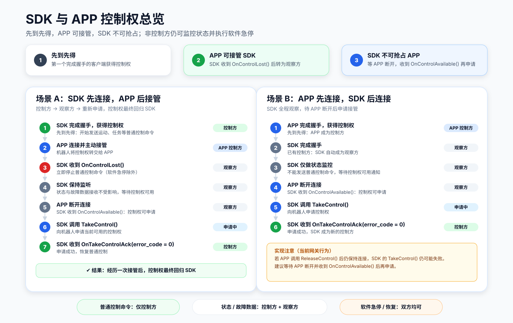
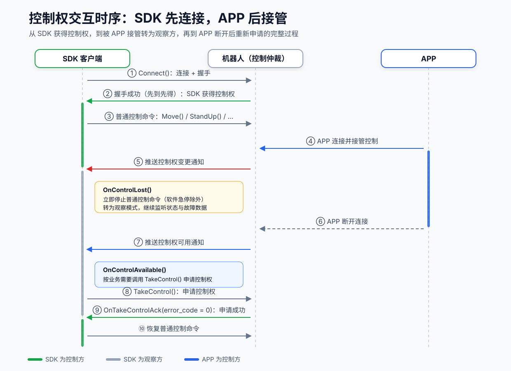
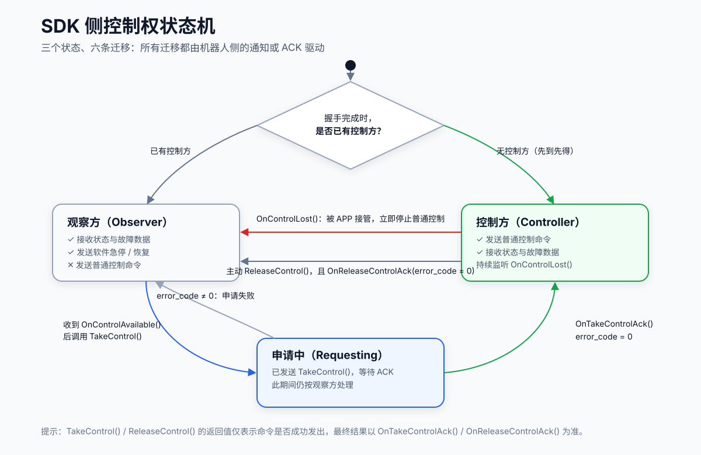

# M1 SDK 控制流程与任务机制

[返回文档总览](../index.md) | [M1 SDK 快速开始](./04-sdk-quickstart.md) | [M1 SDK 接口参考](./06-sdk-api-reference.md) | [回调、数据类型与状态参考](./07-callbacks-data-types-and-status-reference.md)

## 应用运行流程

一个完整的 M1 SDK 控制程序按以下顺序运行：

1. 创建 `SDKClient`。
2. 注册 `IDataCallback` 和 `IControlCallback`。
3. 调用 `Connect()` 并等待握手成功。
4. 调用 `GetDeviceInfo()` 确认设备类型。
5. 确认控制权，并在需要时调用 `TakeControl()`。
6. 发送姿态、运动、任务或设备控制命令。
7. 持续处理状态、故障、应答和连接变化。
8. 停止运动，释放控制权并调用 `Disconnect(true)`。

## 调用结果的三个层次

SDK 调用需要分别判断发送、应答和执行状态：

| 层次 | 判断方式 | 表示的结果 |
| --- | --- | --- |
| 调用层 | 函数返回值或 `WriteHandler` | 本次接口调用是否返回错误 |
| 应答层 | `IControlCallback` | 机器人是否接收并处理该命令 |
| 执行层 | `RobotState` 或 `IDataCallback` | 动作或任务是否正在运行、完成或失败 |

接口调用未返回错误不等于动作完成。例如，`StandUp()` 调用成功后仍需观察 `RobotState::motion_status`；启动回充命令收到应答后，仍需通过 `OnTaskStateData()` 跟踪任务状态。

## 同步与异步调用

命令接口通过 `timeout_ms` 和 `WriteHandler` 控制调用方式：

| 模式 | 使用方式 | 结果获取方式 |
| --- | --- | --- |
| 异步 | `timeout_ms == 0` | 函数立即返回，后续结果由 `WriteHandler` 通知 |
| 同步 | `timeout_ms > 0` | 函数阻塞等待本次调用结果或超时，结果由返回的 `std::error_code` 表示 |

异步调用示例：

```cpp
client.StandUp(0, [](const std::error_code& ec, std::size_t) {
    if (ec) {
        std::cerr << "call failed: " << ec.message() << std::endl;
    }
});
```

同步调用示例：

```cpp
auto ec = client.StandUp(2000);
if (ec) {
    std::cerr << "call failed: " << ec.message() << std::endl;
}
```

不要在 SDK 回调中调用同步接口。回调运行在 SDK I/O 线程中，同步等待可能阻塞后续应答和数据处理。

## 控制权机制

控制权决定哪个客户端可以发送普通运动、姿态、任务和设备控制命令。同一时间只有一个客户端拥有控制权，其他已连接客户端只能接收状态和故障信息。



### 控制权规则

| 规则 | 说明 |
| --- | --- |
| 先连接者获得控制权 | 第一个完成握手的客户端自动成为控制方 |
| 后连接者为观察方 | 可以接收状态，但不能执行普通控制 |
| App 可以接管 SDK | SDK 会收到 `OnControlLost()` |
| SDK 不能抢占 App | App 保持连接并控制时，`TakeControl()` 会失败 |
| 控制方断开后可重新申请 | SDK 收到 `OnControlAvailable()` 后再申请 |
| 失去控制权后立即停手 | 停止发送普通控制命令和连续运动命令 |



### SDK 侧状态



| 状态 | 含义 |
| --- | --- |
| `NO_CONTROL` | SDK 当前没有控制权 |
| `CONTROL_AVAILABLE` | 机器人允许申请控制权 |
| `HAS_CONTROL` | SDK 已经获得控制权 |

### 控制权处理流程

1. 注册控制权事件和应答回调。
2. 握手完成后确认当前是否已经获得控制权。
3. 没有控制权时等待 `OnControlAvailable()`。
4. 在应用工作线程调用 `TakeControl()`。
5. 在 `OnTakeControlAck()` 中判断 `error_code`。
6. 控制期间持续监听 `OnControlLost()`。
7. 失去控制权后立即停止普通控制命令。
8. 退出前调用 `ReleaseControl()`，再断开连接。

函数原型见 [M1 SDK 接口参考](./06-02-robot-control.md#控制权)，事件和应答结构见 [M1 回调、数据类型与状态参考](./07-callbacks-data-types-and-status-reference.md#控制权事件)。

## 充电桩配对

SDK v0.2.3 支持扫描、连接、查询和断开 BLE 充电桩。确认机器人系统支持配对后，先注册数据回调和控制回调，再从应用线程执行以下流程。

1. 调用 `SetDockScanConfig(true)`，等待 `OnDockScanConfig(true)` 确认开始扫描。
2. 通过 `OnDockScanResult()` 接收扫描上报，按地址更新设备列表，选出 `connectable` 为 `true` 的充电桩并保存其地址。
3. 调用 `SetDockScanConfig(false)`，收到关闭扫描确认后，将选中的地址填入 `DockConnectConfig::address` 并调用 `ConnectDock()`。
4. 检查 `OnDockConnectionAck()` 的 `accepted`。请求受理后，等待 `OnDockConnectionResult()` 并检查 `success` 和 `error_code`。
5. 配对成功后调用 `GetDockInfo()`，通过 `OnDockInfo()` 查看 `dock_connected`、`has_contact` 和 `charging_active`。
6. 需要解除连接时调用 `DisconnectDock()`，同样等待受理应答和最终结果。

一次只发起一个连接或断开操作。函数返回值和 `WriteHandler` 用于检查调用与发送结果，`OnDockConnectionResult()` 用于确认配对操作的最终结果。机器人执行自主回充或离桩时，进度和结果由 `OnTaskStateData()` 上报。

参见[接口原型](./06-04-dock-and-tasks.md#充电桩配对)、[回调与数据结构](./07-callbacks-data-types-and-status-reference.md#充电桩数据)和[配对示例](./08-examples-and-troubleshooting.md#充电桩配对示例)。

## 充电与离桩任务

| 函数 | 功能 |
| --- | --- |
| `StartRechargeTask()` | 启动自主回充任务 |
| `StopRechargeTask()` | 停止自主回充任务 |
| `StartUnDockTask()` | 启动自主离桩任务 |
| `StopUnDockTask()` | 停止自主离桩任务 |

任务命令同样需要依次判断调用层、应答层和执行层。`OnStartRechargeTask()` 等应答表示机器人已经处理启动或停止请求，`OnTaskStateData()` 才用于跟踪任务的运行和最终结果。

```cpp
void OnTaskStateData(const TaskStateInfo& info) override {
    if (info.task_type == TaskType::RECHARGING) {
        // 根据 info.task_status 和 info.error_code 处理任务状态
    }
}
```

### 回充任务状态

调用 `StartRechargeTask()` 后，回充任务可能上报：

- `STARTING`：任务开始；
- `RUNNING`：任务执行中；
- `FAILURE`：任务启动或执行失败，此时读取 `TaskStateInfo::error_code`。

回充任务不会自然进入 `SUCCESS`。需要结束回充任务时调用 `StopRechargeTask()`，并等待 `TaskType::RECHARGING` 的状态变为 `STOPPED`。判断任务是否已经进入执行状态时，可结合 `OnStartRechargeTask()`、`TaskStateInfo` 和 `MachineStatus::RECHARGE`。

### 离桩任务状态

调用 `StartUnDockTask()` 后，离桩任务可能按 `STARTING -> RUNNING -> SUCCESS` 流转；执行失败时进入 `FAILURE`。`TaskType::UNDOCK` 和 `TaskStatus::SUCCESS` 表示离桩任务完成。

需要中途停止离桩任务时调用 `StopUnDockTask()`，并等待 `TaskType::UNDOCK` 的状态变为 `STOPPED`。

接口原型见 [M1 SDK 接口参考](./06-04-dock-and-tasks.md#任务和机器状态)，任务状态结构见 [M1 回调、数据类型与状态参考](./07-callbacks-data-types-and-status-reference.md#任务状态)。

参见[回充、离桩与充电桩标定的使用条件和故障排查](https://github.com/zsibot/genisom_robot_sdk/blob/main/docs/zh/sdk_recharge_undock_calibration_conditions_zh.md)。

## 远程和空闲状态切换

| 函数 | 功能 | 应答回调 |
| --- | --- | --- |
| `SwitchRemoteState()` | 切换到远程控制状态 | `OnSwitchRemote()` |
| `SwitchIdleState()` | 切换到空闲状态 | `OnSwitchIdle()` |

应答表示机器人已经处理状态切换命令，实际状态仍需通过 `RobotState::machine_status` 确认。
