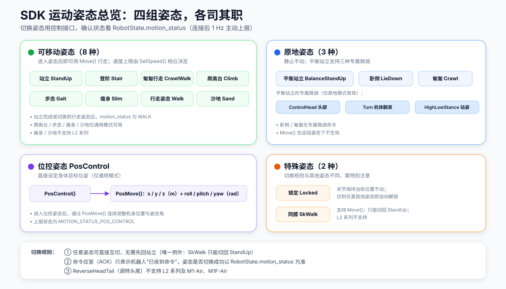

# 机器人控制

[接口概览](./06-sdk-api-reference.md) | [通用参数和返回值](./06-sdk-api-reference.md#通用参数和返回值)

## 控制权

### TakeControl

```cpp
std::error_code TakeControl(
    int timeout_ms = 0,
    WriteHandler handler = [](const std::error_code&, std::size_t) {});
```

申请机器人普通控制权。函数返回值只表示申请命令是否发出，是否真正获得控制权以 `OnTakeControlAck()` 的 `error_code` 为准。

### ReleaseControl

```cpp
std::error_code ReleaseControl(
    int timeout_ms = 0,
    WriteHandler handler = [](const std::error_code&, std::size_t) {});
```

主动释放控制权。程序退出或不再控制机器人时建议调用。

控制权的申请、接管和恢复流程见 [M1 SDK 控制流程与任务机制](./05-sdk-control-flow-and-task-handling.md#控制权机制)。

## 安全控制

### SoftEmergencyStop

```cpp
std::error_code SoftEmergencyStop(
    bool on, int timeout_ms = 0,
    WriteHandler handler = [](const std::error_code&, std::size_t) {});
```

触发或解除软件急停。`on == true` 触发急停，`on == false` 解除急停。软件急停不受普通控制权限制，但不能代替机身硬急停。

应答通过 `IControlCallback::OnSoftEmergencyStop(bool on)` 返回，状态也可以从 `RobotState::software_emergency_status` 读取。

## 姿态控制

以下接口都只有公共参数 `timeout_ms` 和 `handler`：

| 函数 | 原型 | 功能 |
| --- | --- | --- |
| `StandUp` | `std::error_code StandUp(int timeout_ms = 0, WriteHandler handler = ...)` | 站立 |
| `Walk` | `std::error_code Walk(int timeout_ms = 0, WriteHandler handler = ...)` | 切换到可移动的行走姿态 |
| `BalanceStandUp` | `std::error_code BalanceStandUp(int timeout_ms = 0, WriteHandler handler = ...)` | 平衡站立 |
| `LieDown` | `std::error_code LieDown(int timeout_ms = 0, WriteHandler handler = ...)` | 卧倒 |
| `Stair` | `std::error_code Stair(int timeout_ms = 0, WriteHandler handler = ...)` | 登阶姿态 |
| `Crawl` | `std::error_code Crawl(int timeout_ms = 0, WriteHandler handler = ...)` | 匍匐 |
| `CrawlWalk` | `std::error_code CrawlWalk(int timeout_ms = 0, WriteHandler handler = ...)` | 匍匐行走 |
| `Climb` | `std::error_code Climb(int timeout_ms = 0, WriteHandler handler = ...)` | 爬高台 |
| `Gait` | `std::error_code Gait(int timeout_ms = 0, WriteHandler handler = ...)` | 精细步态 |
| `Slim` | `std::error_code Slim(int timeout_ms = 0, WriteHandler handler = ...)` | 瘦身过窄道 |
| `PosControl` | `std::error_code PosControl(int timeout_ms = 0, WriteHandler handler = ...)` | 切换到位控姿态 |
| `SkWalk` | `std::error_code SkWalk(int timeout_ms = 0, WriteHandler handler = ...)` | 同膝行走 |
| `Sand` | `std::error_code Sand(int timeout_ms = 0, WriteHandler handler = ...)` | 沙地姿态 |
| `ReverseHeadTail` | `std::error_code ReverseHeadTail(int timeout_ms = 0, WriteHandler handler = ...)` | 调换头尾方向 |
| `Locked` | `std::error_code Locked(int timeout_ms = 0, WriteHandler handler = ...)` | 锁定关节位置 |



站立完成后，`RobotState::motion_status` 通常变为 `MOTION_STATUS_WALK`，表示机器人已经站好并可以移动。`Locked()` 会保持当前关节位置，下发其他姿态命令会解除锁定。

`Walk()` 自 v0.2.3 提供。收到 `IControlCallback::OnWalk()` 后，通过 `RobotState::motion_status` 确认姿态是否已切换到 `MOTION_STATUS_WALK`。

## 运动控制

### Move

```cpp
std::error_code Move(
    float left_right, float forward_back, float yaw,
    int timeout_ms = 0,
    WriteHandler handler = [](const std::error_code&, std::size_t) {});
```

在通用运动状态下发送平移和旋转速度比例。

| 参数 | 范围 | 说明 |
| --- | --- | --- |
| `left_right` | `[-1.0, 1.0]` | 左右平移比例，正数左移，负数右移 |
| `forward_back` | `[-1.0, 1.0]` | 前后移动比例，正数前进，负数后退 |
| `yaw` | `[-1.0, 1.0]` | 旋转比例，正数左转，负数右转 |

实际速度由 `SetSpeed()` 当前速度档位决定。机器人侧通常只维持最新一条 `Move()` 指令约 1 s，连续运动建议以 10 至 20 Hz 周期发送。

### MoveVelocity

```cpp
std::error_code MoveVelocity(
    float x, float y, float yaw, int timeout_ms = 0,
    WriteHandler handler = [](const std::error_code&, std::size_t) {});
```

按物理单位发送机体坐标系下的速度。`x` 为前后速度，正向朝前，`y` 为横向速度，正向朝左，两者单位均为 m/s。`yaw` 为绕竖直轴的角速度，单位为 rad/s，正向遵循右手定则。

速度受当前 `SetSpeed()` 档位约束，连续运动建议以 10 至 20 Hz 周期发送。参数为 NaN 或无穷值时返回 `std::errc::invalid_argument`。发送结果可通过 `WriteHandler` 检查，该接口无专用控制应答。

### PosMove

```cpp
std::error_code PosMove(
    PosControlCmd cmd, int timeout_ms = 0,
    WriteHandler handler = [](const std::error_code&, std::size_t) {});
```

在位控姿态下发送目标位姿。使用前先调用 `PosControl()`。

```cpp
struct PosControlCmd {
    float x;
    float y;
    float z;
    float roll;
    float pitch;
    float yaw;
};
```

`x/y/z` 单位为 m，`roll/pitch/yaw` 单位为 rad。

### Turn

```cpp
std::error_code Turn(
    int direction, int timeout_ms = 0,
    WriteHandler handler = [](const std::error_code&, std::size_t) {});
```

原地模式下控制机体左右翻滚：`0` 恢复，`1` 左翻滚，`2` 右翻滚。其他值返回 `std::errc::invalid_argument`。

### ControlHead

```cpp
std::error_code ControlHead(
    float left_right, float up_down, int timeout_ms = 0,
    WriteHandler handler = [](const std::error_code&, std::size_t) {});
```

原地模式下控制左右探头和抬头低头。两个参数范围均为 `[-1.0, 1.0]`：正数分别表示向左、向上，负数分别表示向右、向下。

### HighLowStance

```cpp
std::error_code HighLowStance(
    int stance, int timeout_ms = 0,
    WriteHandler handler = [](const std::error_code&, std::size_t) {});
```

调整身体高低站姿：`0` 恢复，`1` 高站姿，`2` 低站姿。

### SetSpeed

```cpp
std::error_code SetSpeed(
    int speed_level, int timeout_ms = 0,
    WriteHandler handler = [](const std::error_code&, std::size_t) {});
```

设置 `Move()` 的速度档位：`1` 低速，`2` 中速，`3` 高速。其他值返回参数错误。速度档位越高，横向移动和旋转的组合范围越小。
