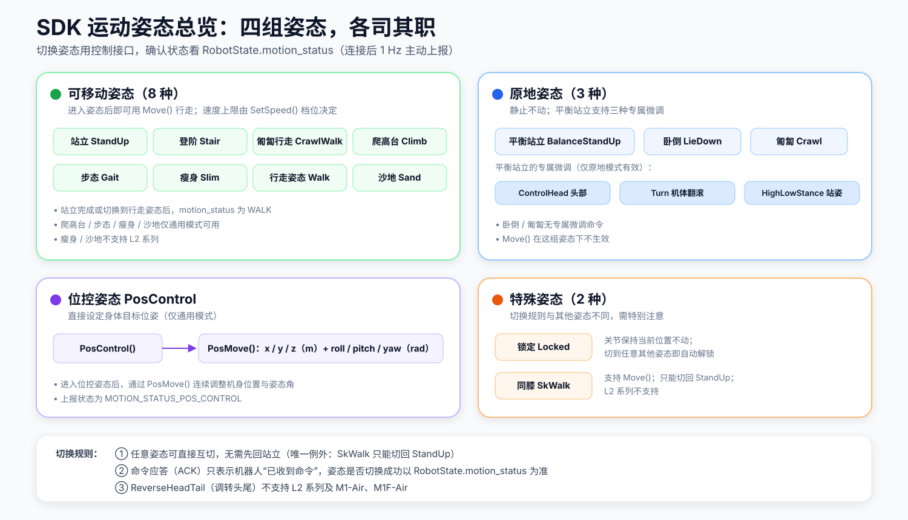

# M1 SDK 接口参考

[返回文档总览](../index.md) | [SDK 控制流程与任务机制](./05-sdk-control-flow-and-task-handling.md) | [回调、数据类型与状态参考](./07-callbacks-data-types-and-status-reference.md) | [示例程序与故障排查](./08-examples-and-troubleshooting.md)

## 接口概览

M1 SDK 的核心类是 `robot_sdk::SDKClient`，头文件为 `robot_sdk/sdk_client.hpp`。接口返回值统一为 `std::error_code`，控制命令的发送结果和机器人业务结果需要分别判断。连接、控制权和任务状态之间的关系见 [M1 SDK 控制流程与任务机制](./05-sdk-control-flow-and-task-handling.md)。

接口调用分为以下几类：

| 类别 | 主要接口 |
| --- | --- |
| 连接管理 | `Connect()`、`Disconnect()`、`IsConnected()`、`GetConnectionState()` |
| 回调设置 | `SetControlCallback()`、`SetDataCallback()` |
| 安全控制 | `SoftEmergencyStop()` |
| 姿态控制 | `StandUp()`、`Walk()`、`BalanceStandUp()`、`LieDown()`、`Stair()`、`Crawl()`、`CrawlWalk()`、`Climb()`、`Slim()`、`Gait()`、`PosControl()`、`SkWalk()`、`Sand()`、`ReverseHeadTail()`、`Locked()` |
| 运动控制 | `Move()`、`MoveVelocity()`、`PosMove()`、`Turn()`、`ControlHead()`、`HighLowStance()`、`SetSpeed()` |
| 灯光与感知 | `FrontLight()`、`BackLight()`、`AutoModeLight()`、`ObstacleAvoidance()` |
| 数据上报配置 | `SetImuConfig()`、`SetLuxConfig()`、`SetMcConfig()`、`SetSpeedReportConfig()`、`SetJointStateConfig()` |
| 控制权 | `TakeControl()`、`ReleaseControl()` |
| 相机 | `UpdateCameraBitrate()` |
| 充电桩配对 | `SetDockScanConfig()`、`ConnectDock()`、`GetDockInfo()`、`DisconnectDock()` |
| 任务与状态 | `StartRechargeTask()`、`StopRechargeTask()`、`StartUnDockTask()`、`StopUnDockTask()`、`SwitchRemoteState()`、`SwitchIdleState()` |
| 外设电源 | `SetPeriphPower()`、`GetPeriphPower()` |
| LED | `SetLedAutoMode()`、`GetLedAutoMode()`、`SetLedCommand()` |
| 版本和设备信息 | `Version()`、`ProtocolVersion()`、`SystemVersion()`、`GetDeviceInfo()` |

## 通用参数和返回值

除 `Connect()`、`Disconnect()`、状态查询和版本查询接口外，命令接口通常包含以下公共参数：

| 参数 | 类型 | 说明 |
| --- | --- | --- |
| `timeout_ms` | `int` | `0` 表示异步发送；大于 `0` 表示同步等待，单位为毫秒 |
| `handler` | `WriteHandler` | 异步模式下接收发送结果的回调 |

```cpp
using WriteHandler =
    std::function<void(const std::error_code&, std::size_t)>;
```

返回值的含义：

- 异步模式下，函数立即返回，后续结果由 `handler` 返回。
- 同步模式下，函数阻塞等待本次调用结果或超时，结果由返回的 `std::error_code` 表示。
- 机器人是否实际执行命令，还要看对应的控制应答回调、状态回调或 `RobotState`。

常见错误：

| 错误 | 整数值 | 含义 |
| --- | ---: | --- |
| `robot_sdk::Errc::Success` | 0 | 成功 |
| `robot_sdk::Errc::ShakeHandFailed` | 10000 | 握手失败 |
| `robot_sdk::Errc::ProtocolMismatch` | 10001 | 协议版本不匹配 |
| `robot_sdk::Errc::ControlledDenial` | 10002 | 控制被拒绝 |
| `robot_sdk::Errc::ConnectFailed` | 10003 | 连接失败 |
| `robot_sdk::Errc::UnsupportedDeviceOperation` | 10004 | 当前机型不支持该操作 |
| `robot_sdk::Errc::UnknownError` | 19999 | 未分类的 SDK 错误 |
| `std::errc::invalid_argument` | — | 参数越界或参数组合无效 |
| `std::errc::not_connected` | — | 尚未建立连接 |
| `std::errc::timed_out` | — | 等待超时 |
| `std::errc::operation_canceled` | — | 操作已取消 |
| `std::errc::operation_in_progress` | — | 相同操作正在进行 |

### 判断与记录 SDK 错误

应用可直接与 `robot_sdk::Errc` 枚举比较。`Errc::UnsupportedDeviceOperation` 也可用标准错误条件 `std::errc::operation_not_supported` 判断。

```cpp
// ec 为 SDK 接口返回的 std::error_code。
if (ec) {
    std::cerr << ec.category().name() << " [" << ec.value()
              << "] " << ec.message() << '\n';
    if (ec == robot_sdk::Errc::UnsupportedDeviceOperation) {
        // 按当前机型禁用相应功能。
    }
}
```

SDK 专用错误的类别名为 `Robot`。回充与离桩失败时，查询[任务业务错误码](./07-callbacks-data-types-and-status-reference.md#回充与离桩业务错误码)。扩展说明见[官方 SDK 错误码文档](https://github.com/zsibot/genisom_robot_sdk/blob/main/docs/zh/sdk_error_zh.md)。

## 构造与连接

### SDKClient

```cpp
SDKClient(
    ErrorHandler error_callback = [](const std::error_code&) {},
    ConnectionConfig connection_config = ConnectionConfig(),
    TransportProtocol type = TransportProtocol::Udp);
```

创建 SDK 客户端。`type` 支持 `TransportProtocol::Udp` 和 `TransportProtocol::WebSocket`，默认使用 UDP。

`ConnectionConfig` 的连接与重连参数：

| 字段 | 说明 |
| --- | --- |
| `connect_timeout_ms` | 连接和握手超时时间，默认 5000 ms，最小 500 ms |
| `auto_reconnect` | 是否开启自动重连，默认 `false` |
| `reconnect_interval_ms` | 自动重连间隔，默认 1000 ms，最小 500 ms |

### Connect

```cpp
std::error_code Connect(
    std::string ip, std::string port, bool block = false,
    ConnectHandler handler = [](const std::error_code&) {});
```

建立传输连接并完成协议握手。只有握手成功后才算连接成功。

从 SDK v0.2.3 起，首次连接因传输、握手、协议不匹配或控制被拒绝而失败后，可在同一个 `SDKClient` 实例上再次调用 `Connect()`。异步连接应等待本次失败结果再由应用线程发起重试。

| 参数 | 说明 |
| --- | --- |
| `ip` | 机器人地址，例如 `192.168.234.1` 或 `192.168.168.168` |
| `port` | UDP 通常使用 `8082`，WebSocket 使用 `8081` |
| `block` | `false`：异步连接；`true`：阻塞等待连接完成 |
| `handler` | 异步连接结果回调 |

```cpp
SDKClient client;
auto ec = client.Connect("192.168.234.1", "8082", true);
if (ec) {
    std::cerr << "connect failed: " << ec.message() << std::endl;
}
```

### Disconnect

```cpp
std::error_code Disconnect(
    bool block = false,
    DisConnectHandler handler = [](const std::error_code&) {});
```

主动断开连接。UDP 模式下 SDK 会先发送断开通知，再释放连接资源。

### IsConnected

```cpp
bool IsConnected() const;
```

返回 `true` 表示已经完成握手并处于 `ConnectionState::CONNECTED` 状态。

### GetConnectionState

```cpp
ConnectionState GetConnectionState() const;
```

返回当前连接状态：

| 枚举值 | 整数值 | 含义 |
| --- | ---: | --- |
| `DISCONNECTING` | 0 | 断开中 |
| `DISCONNECTED` | 1 | 已断开 |
| `CONNECTING` | 2 | 连接中 |
| `HANDSHAKING` | 3 | 握手中 |
| `CONNECTED` | 4 | 已连接 |
| `RECONNECTING` | 5 | 自动重连中 |

## 安全控制

### SoftEmergencyStop

```cpp
std::error_code SoftEmergencyStop(
    bool on, int timeout_ms = 0,
    WriteHandler handler = [](const std::error_code&, std::size_t) {});
```

触发或解除软件急停。`on == true` 触发急停，`on == false` 解除急停。软件急停不受普通控制权限制，但不能代替机身硬急停。

应答通过 `IControlCallback::OnSoftEmergencyStop(bool on)` 返回，状态也可以从 `RobotState::software_emergency_status` 读取。

## 姿态控制

以下接口都只有公共参数 `timeout_ms` 和 `handler`：

| 函数 | 原型 | 功能 |
| --- | --- | --- |
| `StandUp` | `std::error_code StandUp(int timeout_ms = 0, WriteHandler handler = ...)` | 站立 |
| `Walk` | `std::error_code Walk(int timeout_ms = 0, WriteHandler handler = ...)` | 切换到可移动的行走姿态 |
| `BalanceStandUp` | `std::error_code BalanceStandUp(int timeout_ms = 0, WriteHandler handler = ...)` | 平衡站立 |
| `LieDown` | `std::error_code LieDown(int timeout_ms = 0, WriteHandler handler = ...)` | 卧倒 |
| `Stair` | `std::error_code Stair(int timeout_ms = 0, WriteHandler handler = ...)` | 登阶姿态 |
| `Crawl` | `std::error_code Crawl(int timeout_ms = 0, WriteHandler handler = ...)` | 匍匐 |
| `CrawlWalk` | `std::error_code CrawlWalk(int timeout_ms = 0, WriteHandler handler = ...)` | 匍匐行走 |
| `Climb` | `std::error_code Climb(int timeout_ms = 0, WriteHandler handler = ...)` | 爬高台 |
| `Gait` | `std::error_code Gait(int timeout_ms = 0, WriteHandler handler = ...)` | 精细步态 |
| `Slim` | `std::error_code Slim(int timeout_ms = 0, WriteHandler handler = ...)` | 瘦身过窄道 |
| `PosControl` | `std::error_code PosControl(int timeout_ms = 0, WriteHandler handler = ...)` | 切换到位控姿态 |
| `SkWalk` | `std::error_code SkWalk(int timeout_ms = 0, WriteHandler handler = ...)` | 同膝行走 |
| `Sand` | `std::error_code Sand(int timeout_ms = 0, WriteHandler handler = ...)` | 沙地姿态 |
| `ReverseHeadTail` | `std::error_code ReverseHeadTail(int timeout_ms = 0, WriteHandler handler = ...)` | 调换头尾方向 |
| `Locked` | `std::error_code Locked(int timeout_ms = 0, WriteHandler handler = ...)` | 锁定关节位置 |



站立完成后，`RobotState::motion_status` 通常变为 `MOTION_STATUS_WALK`，表示机器人已经站好并可以移动。`Locked()` 会保持当前关节位置，下发其他姿态命令会解除锁定。

`Walk()` 自 v0.2.3 提供。收到 `IControlCallback::OnWalk()` 后，通过 `RobotState::motion_status` 确认姿态是否已切换到 `MOTION_STATUS_WALK`。

`ReverseHeadTail()` 不支持 `DeviceType::M1_AIR` 和 `DeviceType::M1F_AIR`。在这两种机型上调用时，SDK 返回 `Errc::UnsupportedDeviceOperation`，不会发送协议命令。

## 运动控制

### Move

```cpp
std::error_code Move(
    float left_right, float forward_back, float yaw,
    int timeout_ms = 0,
    WriteHandler handler = [](const std::error_code&, std::size_t) {});
```

在通用运动状态下发送平移和旋转速度比例。

| 参数 | 范围 | 说明 |
| --- | --- | --- |
| `left_right` | `[-1.0, 1.0]` | 左右平移比例，正数左移，负数右移 |
| `forward_back` | `[-1.0, 1.0]` | 前后移动比例，正数前进，负数后退 |
| `yaw` | `[-1.0, 1.0]` | 旋转比例，正数左转，负数右转 |

实际速度由 `SetSpeed()` 当前速度档位决定。机器人侧通常只维持最新一条 `Move()` 指令约 1 s，连续运动建议以 10 至 20 Hz 周期发送。

### MoveVelocity

```cpp
std::error_code MoveVelocity(
    float x, float y, float yaw, int timeout_ms = 0,
    WriteHandler handler = [](const std::error_code&, std::size_t) {});
```

按物理单位发送机体坐标系下的速度。`x` 为前后速度，正向朝前，`y` 为横向速度，正向朝左，两者单位均为 m/s。`yaw` 为绕竖直轴的角速度，单位为 rad/s，正向遵循右手定则。

速度受当前 `SetSpeed()` 档位约束，连续运动建议以 10 至 20 Hz 周期发送。参数为 NaN 或无穷值时返回 `std::errc::invalid_argument`。发送结果可通过 `WriteHandler` 检查，该接口无专用控制应答。

### PosMove

```cpp
std::error_code PosMove(
    PosControlCmd cmd, int timeout_ms = 0,
    WriteHandler handler = [](const std::error_code&, std::size_t) {});
```

在位控姿态下发送目标位姿。使用前先调用 `PosControl()`。

```cpp
struct PosControlCmd {
    float x;
    float y;
    float z;
    float roll;
    float pitch;
    float yaw;
};
```

`x/y/z` 单位为 m，`roll/pitch/yaw` 单位为 rad。

### Turn

```cpp
std::error_code Turn(
    int direction, int timeout_ms = 0,
    WriteHandler handler = [](const std::error_code&, std::size_t) {});
```

原地模式下控制机体左右翻滚：`0` 恢复，`1` 左翻滚，`2` 右翻滚。其他值返回 `std::errc::invalid_argument`。

### ControlHead

```cpp
std::error_code ControlHead(
    float left_right, float up_down, int timeout_ms = 0,
    WriteHandler handler = [](const std::error_code&, std::size_t) {});
```

原地模式下控制左右探头和抬头低头。两个参数范围均为 `[-1.0, 1.0]`：正数分别表示向左、向上，负数分别表示向右、向下。

### HighLowStance

```cpp
std::error_code HighLowStance(
    int stance, int timeout_ms = 0,
    WriteHandler handler = [](const std::error_code&, std::size_t) {});
```

调整身体高低站姿：`0` 恢复，`1` 高站姿，`2` 低站姿。

### SetSpeed

```cpp
std::error_code SetSpeed(
    int speed_level, int timeout_ms = 0,
    WriteHandler handler = [](const std::error_code&, std::size_t) {});
```

设置 `Move()` 的速度档位：`1` 低速，`2` 中速，`3` 高速。其他值返回参数错误。速度档位越高，横向移动和旋转的组合范围越小。

## 灯光与感知开关

```cpp
std::error_code FrontLight(bool on, int timeout_ms = 0, WriteHandler handler = ...);
std::error_code BackLight(bool on, int timeout_ms = 0, WriteHandler handler = ...);
std::error_code AutoModeLight(bool on, int timeout_ms = 0, WriteHandler handler = ...);
std::error_code ObstacleAvoidance(bool on, int timeout_ms = 0, WriteHandler handler = ...);
```

| 函数 | 功能 |
| --- | --- |
| `FrontLight` | 开关前补光灯 |
| `BackLight` | 开关后补光灯 |
| `AutoModeLight` | 开关自动补光模式 |
| `ObstacleAvoidance` | 开关停障功能 |

四个函数的 `on` 参数为 `true` 开启、`false` 关闭。当前状态通过 `RobotState` 的 `front_fill_light`、`back_fill_light`、`auto_mode_light` 和 `obstacle_avoidance` 获取。

`BackLight()` 不支持 `DeviceType::M1_AIR` 和 `DeviceType::M1F_AIR`。在这两种机型上调用时，SDK 返回 `Errc::UnsupportedDeviceOperation`。

## 数据上报配置

机器人默认主动上报 `RobotState` 和故障信息。下面的接口用于开启或调整传感器和高频状态数据：

| 函数 | 原型 | 回调 | 说明 |
| --- | --- | --- | --- |
| `SetImuConfig` | `std::error_code SetImuConfig(int freq, int timeout_ms = 0, WriteHandler handler = ...)` | `OnImuData` | `freq` 为上报频率，`0` 表示关闭 |
| `SetLuxConfig` | `std::error_code SetLuxConfig(bool on, int timeout_ms = 0, WriteHandler handler = ...)` | `OnLuxData` | 光照强度，开启后固定 1 Hz |
| `SetMcConfig` | `std::error_code SetMcConfig(bool on, int timeout_ms = 0, WriteHandler handler = ...)` | `OnMcData` | 运动数据，开启后固定 50 Hz |
| `SetSpeedReportConfig` | `std::error_code SetSpeedReportConfig(bool on, uint32_t frequency, int timeout_ms = 0, WriteHandler handler = ...)` | `OnSpeedData` | 速度上报频率 1 至 50 Hz |
| `SetJointStateConfig` | `std::error_code SetJointStateConfig(bool on, int timeout_ms = 0, WriteHandler handler = ...)` | `OnJointStateData` | 开关关节状态上报 |

配置命令的生效结果通过 `IControlCallback` 中对应的配置应答回调获取。

## 控制权

### TakeControl

```cpp
std::error_code TakeControl(
    int timeout_ms = 0,
    WriteHandler handler = [](const std::error_code&, std::size_t) {});
```

申请机器人普通控制权。函数返回值只表示申请命令是否发出，是否真正获得控制权以 `OnTakeControlAck()` 的 `error_code` 为准。

### ReleaseControl

```cpp
std::error_code ReleaseControl(
    int timeout_ms = 0,
    WriteHandler handler = [](const std::error_code&, std::size_t) {});
```

主动释放控制权。程序退出或不再控制机器人时建议调用。

控制权的申请、接管和恢复流程见 [M1 SDK 控制流程与任务机制](./05-sdk-control-flow-and-task-handling.md#控制权机制)。

## 相机码率

### UpdateCameraBitrate

```cpp
std::error_code UpdateCameraBitrate(
    CameraBitrateCmd cmd, int timeout_ms = 0,
    WriteHandler handler = [](const std::error_code&, std::size_t) {});
```

```cpp
struct CameraBitrateCmd {
    std::string camera_name;
    uint32_t camera_bps;
};
```

| 字段 | 要求 |
| --- | --- |
| `camera_name` | `camera_front` 或 `camera_back` |
| `camera_bps` | 50000 至 100000000 bit/s |

设备实际生效值通过 `OnUpdateCameraBitrateAck()` 返回。修改码率后应同时观察 RTSP 视频流和网络负载。

## 充电桩配对

以下接口自 SDK v0.2.3 提供，`timeout_ms` 和 `handler` 遵循[通用参数规则](#通用参数和返回值)。

| 函数原型 | 协议类型 | 应答与结果 |
| --- | --- | --- |
| `std::error_code SetDockScanConfig(bool on, int timeout_ms = 0, WriteHandler handler = ...)` | 1008（`target=302`） | `OnDockScanConfig()` 确认开启或停止扫描，`OnDockScanResult()` 上报发现的设备（1018） |
| `std::error_code ConnectDock(const DockConnectConfig& config, int timeout_ms = 0, WriteHandler handler = ...)` | 1022 | 通过 `config.address` 指定充电桩。检查 `OnDockConnectionAck()` 的受理结果和 `OnDockConnectionResult()` 的最终结果（1024） |
| `std::error_code GetDockInfo(int timeout_ms = 0, WriteHandler handler = ...)` | 1023 | `OnDockInfo()` 返回充电桩信息以及连接、接触和充电状态 |
| `std::error_code DisconnectDock(int timeout_ms = 0, WriteHandler handler = ...)` | 1022 | 断开当前充电桩，使用与连接操作相同的应答和结果回调 |

调用顺序见[充电桩配对流程](./05-sdk-control-flow-and-task-handling.md#充电桩配对)，字段说明见[充电桩数据](./07-callbacks-data-types-and-status-reference.md#充电桩数据)。

## 任务和机器状态

```cpp
std::error_code StartRechargeTask(int timeout_ms = 0, WriteHandler handler = ...);
std::error_code StopRechargeTask(int timeout_ms = 0, WriteHandler handler = ...);
std::error_code StartUnDockTask(int timeout_ms = 0, WriteHandler handler = ...);
std::error_code StopUnDockTask(int timeout_ms = 0, WriteHandler handler = ...);
std::error_code SwitchRemoteState(int timeout_ms = 0, WriteHandler handler = ...);
std::error_code SwitchIdleState(int timeout_ms = 0, WriteHandler handler = ...);
```

| 函数 | 功能 |
| --- | --- |
| `StartRechargeTask` | 启动自主回充任务 |
| `StopRechargeTask` | 停止自主回充任务 |
| `StartUnDockTask` | 启动自主离桩任务 |
| `StopUnDockTask` | 停止自主离桩任务 |
| `SwitchRemoteState` | 切换到远程控制状态 |
| `SwitchIdleState` | 切换到空闲状态 |

命令发送结果由返回值或 `WriteHandler` 获取；命令应答由 `IControlCallback` 获取；任务执行过程和最终状态由 `OnTaskStateData()` 获取。不要把“命令已发送”当作“任务已完成”。

充电、离桩和状态切换的完整处理流程见 [M1 SDK 控制流程与任务机制](./05-sdk-control-flow-and-task-handling.md#充电与离桩任务)。

## 外设电源

### SetPeriphPower

```cpp
std::error_code SetPeriphPower(
    const PowerCtrlCfg& cfg, int timeout_ms = 0,
    WriteHandler handler = [](const std::error_code&, std::size_t) {});
```

```cpp
struct PowerCtrlCfg {
    PeripheralPower power;
    bool enable;
};
```

`power` 可设置为 `M1_12V`、`M1_24V` 或 `M1_48V`，`enable` 为 `true` 上电、`false` 断电。应答通过 `OnSetPeriphPower()` 返回。

### GetPeriphPower

```cpp
std::error_code GetPeriphPower(
    const PowerCtrlCfg& cfg, int timeout_ms = 0,
    WriteHandler handler = [](const std::error_code&, std::size_t) {});
```

查询指定电源通道状态。查询时主要填写 `cfg.power`，结果通过 `OnGetPeriphPower()` 返回，`ack.enable` 表示当前实际状态。

## LED 灯效

```cpp
std::error_code SetLedAutoMode(
    bool auto_mode, int timeout_ms = 0, WriteHandler handler = ...);
std::error_code GetLedAutoMode(
    int timeout_ms = 0, WriteHandler handler = ...);
std::error_code SetLedCommand(
    const LedCommand& cmd, int timeout_ms = 0, WriteHandler handler = ...);
```

| 接口 | 功能 |
| --- | --- |
| `SetLedAutoMode` | 设置 LED 自动或手动模式 |
| `GetLedAutoMode` | 查询 LED 当前模式 |
| `SetLedCommand` | 设置灯分组、灯效、颜色和灯效周期 |

```cpp
struct LedCommand {
    LedId id;
    LedEffect effect;
    LedColor color;
    uint32_t duration_ms;
};
```

`duration_ms` 表示灯效周期或闪烁间隔，单位为毫秒。`OFF`、`ON` 通常传 `0`；呼吸和闪烁灯效传所需周期值。

示例：

```cpp
LedCommand cmd{LedId::ALL, LedEffect::BLINK, {255, 128, 0, 255}, 300};
client.SetLedCommand(cmd);
```

`LedId::UNKNOWN` 或 `LedEffect::UNKNOWN` 会返回 `std::errc::invalid_argument`。设置和查询结果通过对应的 `IControlCallback` 回调获取。

状态 LED 与前后补光灯不是同一组接口。前后补光灯使用 `FrontLight()`、`BackLight()` 和 `AutoModeLight()`。

### 自动与手动模式

| 模式 | 行为与调用顺序 |
| --- | --- |
| 手动 | 调用 `SetLedAutoMode(false)`，等 `OnSetLedAutoMode()` 确认 `auto_mode == false` 后，再用 `SetLedCommand()` 设置自定义灯效。 |
| 自动 | 调用 `SetLedAutoMode(true)`，等应答确认 `auto_mode == true`。此时 `SetLedCommand()` 提交的是用户灯效事件，设备会按自身策略决定展示效果。故障、急停、告警或低电量提示可能覆盖用户灯效。 |

当前模式可通过 `GetLedAutoMode()` 查询，并在 `OnGetLedAutoMode()` 中读取。现场联调时请观察设备实际显示的灯效。[官方 LED 指南](https://github.com/zsibot/genisom_robot_sdk/blob/main/docs/en/sdk_led_control_en.md)

## 版本和设备信息

| 函数 | 原型 | 说明 |
| --- | --- | --- |
| `Version` | `const std::string& Version() const` | SDK 版本 |
| `ProtocolVersion` | `const std::string& ProtocolVersion() const` | 通信协议版本 |
| `SystemVersion` | `const std::string& SystemVersion() const` | 握手得到的机器人系统版本 |
| `GetDeviceInfo` | `DeviceInfo GetDeviceInfo() const` | 获取握手缓存的机型和序列号 |

```cpp
struct DeviceInfo {
    DeviceType device_type = DeviceType::UNKNOWN;
    std::string sn;
};
```

示例：

```cpp
auto ec = client.Connect("192.168.234.1", "8082", true);
if (!ec) {
    const auto info = client.GetDeviceInfo();
    std::cout << DeviceTypeName(info.device_type)
              << " / " << info.sn << std::endl;
}
```

连接成功前或断开后，`device_type` 可能为 `DeviceType::UNKNOWN`，`sn` 可能为空。

## M1 机型判断

SDK 会在握手时返回 `DeviceType`。启动后应先调用 `GetDeviceInfo()`，再根据返回型号启用功能。M1 相关枚举值见 [M1 回调、数据类型与状态参考](./07-callbacks-data-types-and-status-reference.md#deviceinfo-和-devicetype)。

调用当前型号不支持的操作时，SDK 返回 `Errc::UnsupportedDeviceOperation`，不会发送协议命令。

| API | M1 Air、M1F Air | 其他 M1 机型 |
| --- | --- | --- |
| `ReverseHeadTail()` | 不支持 | 支持 |
| `BackLight()` | 不支持 | 支持 |

回充、离桩、外设电源和状态 LED 还取决于设备硬件与系统配置。完整的接口支持范围见[官方机型能力矩阵](https://github.com/zsibot/genisom_robot_sdk/blob/main/docs/en/sdk_api_capability_en.md)。

完整的接口组合方式见 [M1 示例程序与故障排查](./08-examples-and-troubleshooting.md)。
