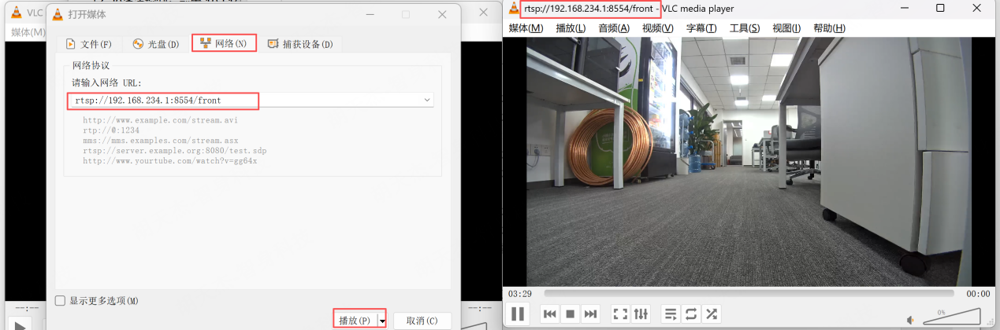
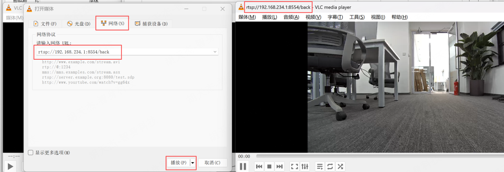

# 视频流读取

[返回文档总览](../index.md)

M1 前置和后置摄像头提供 RTSP 视频流。按开发电脑的接入方式选择地址，再用 VLC 播放。

## 连接与流地址

- **Wi-Fi**：连接机器人的 `M1-xxxxxxx` 热点，出厂密码为 `12345678`。
- **网线**：将开发电脑接到机器人网口，并将电脑的 IPv4 地址配置在同一网段，例如 `192.168.168.12/24`。

| 接入方式 | 前置摄像头 | 后置摄像头 |
| --- | --- | --- |
| Wi-Fi | `rtsp://192.168.234.1:8554/front` | `rtsp://192.168.234.1:8554/back` |
| G20 遥控器通道 | `rtsp://192.168.144.144:8554/front` | `rtsp://192.168.144.144:8554/back` |
| 网线 | `rtsp://192.168.168.168:8554/front` | `rtsp://192.168.168.168:8554/back` |

## 使用 VLC 播放

1. 打开 VLC，选择“媒体” → “打开网络串流”。
2. 在“网络”选项卡输入对应摄像头的 RTSP 地址。
3. 点击“播放”，确认显示的是所选摄像头的画面。

### Wi-Fi 前置摄像头示例

### Wi-Fi 后置摄像头示例

无法播放时，先核对接入方式、目标 IP 和流路径（`/front` 或 `/back`）。相机码率配置见[相机码率接口](./06-05-peripherals-and-camera.md#相机码率)。
