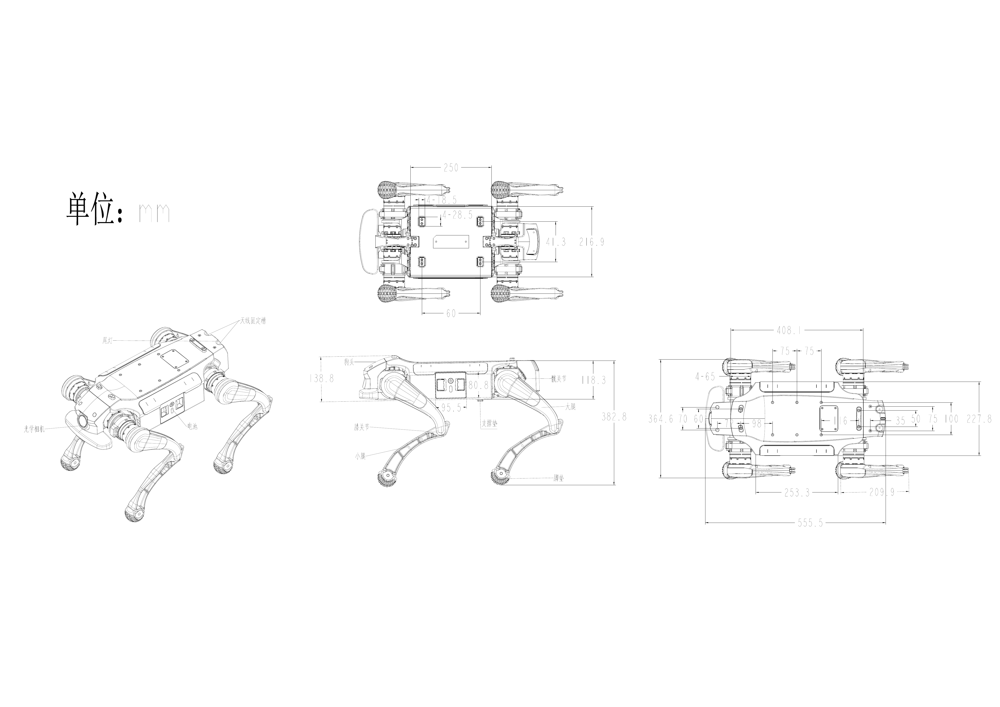
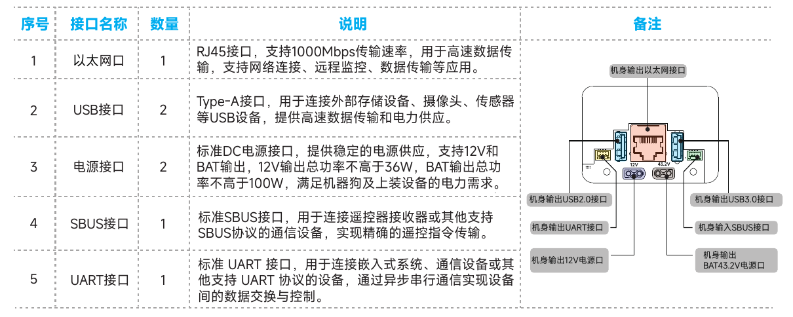

# 二次开发硬件接口说明

[返回总体介绍](../总体介绍.md) | [硬件、软件与结构架构](./03-硬件、软件与结构架构.md) | [SDK 软件服务接口](./06-SDK软件服务接口.md)

## 适用范围

本页说明机器人本体用于二次开发的尺寸、负载设计参考、外观模型、外部接口及已公开的供电参数。

软件通信和控制程序请查看[硬件、软件与结构架构](./03-硬件、软件与结构架构.md)及[SDK 软件服务接口](./06-SDK软件服务接口.md)。

## ZSL-1 尺寸与安装参考

## 负载设计参考与模型下载

| 资料 | 用途 | 下载 |
| --- | --- | --- |
| ZSL-1 负载能力设计参考 | 查看不同负载质心位置对应的负载参考值、坐标定义和实验条件 | [下载 PDF](../assets/downloads/智身四足机器人ZSL-1负载能力设计参考.pdf) |
| ZSL-1 外观模型 | 用于外观尺寸查看、上装布局和空间配合参考 | [下载 STP 模型（约 31 MB）](../assets/downloads/智身四足机器人ZSL-1外观模型.stp) |

负载参考 PDF 中的表格数据为仿真实验结果，条件为平坦路面、机器人以 2 m/s 速度奔跑。实际应用需结合质心位置、路面和运动工况调整；上下坡、上下楼梯时应降低负载。具体坐标定义和适用条件请查看 PDF。

以上资料针对 ZSL-1，其他机型及带上装配置应结合实际设备核对尺寸和可用载荷。

## 机身拓展接口

本体顶部拓展区提供网络、USB、电源和串行通信接口，可用于连接开发电脑、嵌入式计算平台、相机、传感器或遥控接收机。

| 接口 | 数量 | 主要用途或参数 |
| --- | ---: | --- |
| 千兆 RJ45 以太网 | 1 | 网络连接、远程监控和数据传输 |
| Type-A USB | 2 | 连接 USB 外部设备 |
| 12 V 电源 | 1 | 输出总功率不高于 36 W |
| BAT 43.2 V 电源 | 1 | 输出总功率不高于 100 W |
| SBUS | 1 | 连接 SBUS 设备 |
| UART | 1 | 异步串行通信 |

## 电源接口

### 12 V 输出

12 V 接口用于给拓展计算平台、传感器或通信设备供电，总功率不高于 36 W。

### BAT 43.2 V 输出

BAT 接口输出标称电压为 43.2 V，总功率不高于 100 W。

## 网络接口

千兆 RJ45 以太网接口可用于网络连接、远程监控和数据传输。

## USB 接口

机身提供两个 Type-A USB 接口，用于连接 USB 外部设备。

## 串行接口

### SBUS

机身提供 1 个 SBUS 接口。

### UART

机身提供 1 个标准 UART 接口，用于异步串行通信。接线时应使用与当前设备配套的接口定义确认针脚、电平和通信参数。
